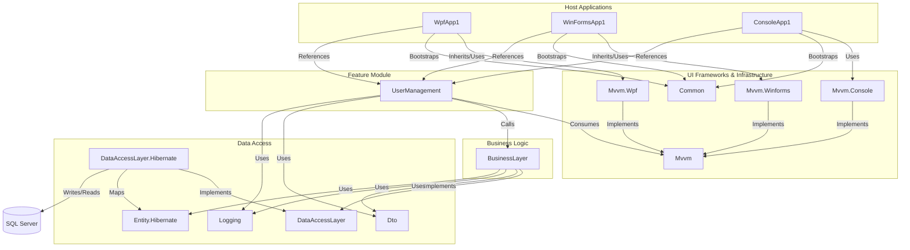

# Demo

## Overview

**Demo** is a .NET solution that demonstrates a layered, MEF (Managed Extensibility Framework)-based MVVM architecture for Windows desktop applications. It solves the problem of building UI-agnostic business logic that can be hosted by multiple front-end technologies (WPF, WinForms, and Console) without code duplication.

The repository is designed for developers looking to understand how to structure enterprise-style C# applications using strict dependency inversion. Its distinctive feature is the use of MEF for plugin-style discovery and composition, allowing the core business logic to remain completely decoupled from specific UI frameworks. The system includes a sample "User Management" feature to demonstrate data persistence, validation, and inter-view communication across these different host environments.

## Repository Description

A demonstration of a modular .NET application using MEF, MVVM, and NHibernate, supporting WPF, WinForms, and Console hosts.

## Architecture Overview

The system follows a strict layered architecture where dependency flow is strictly top-down, from UI hosts to business logic and data access. The primary design pattern is **plugin-based composition** via MEF.

A request enters through a host application (`WpfApp1`, `WinFormsApp1`, or `ConsoleApp1`). The host bootstraps a `CompositionContainer` using the `CompositionHelper` from the `Common` project. This container scans the output directory for assemblies and discovers classes marked with MEF attributes. The host then resolves an `IModuleController` (specifically `DefaultModuleController`), which orchestrates the lifecycle (`Initialize`, `Run`) of the application modules.

The core feature is the `UserManagement` module, which contains the ViewModels. These ViewModels depend on the `BusinessLayer` for logic and `DataAccessLayer` for data. The `BusinessLayer` contains `UserService`, which handles domain logic and translates `UserDto` objects into persistent entities. Persistence is handled by `DataAccessLayer.Hibernate`, which uses NHibernate to communicate with a SQL Server database.

## Main Components

*   **UI Hosts (`WpfApp1`, `WinFormsApp1`, `ConsoleApp1`)**: These are thin executable shells. They initialize the MEF container, discover the `DefaultModuleController`, and manage the application lifecycle. They contain no business logic, only bootstrap code and framework-specific adapters (like `MessageService` implementations in `Mvvm.Wpf`, etc.).
*   **`UserManagement`**: The core feature module implementing the MVVM pattern. It contains `UserViewModel`, `AddUserViewModel`, and `ShowUsersViewModel`. These components use `FluentValidation` for input checks and `WeakReferenceMessenger` to communicate state changes (e.g., user added) without direct coupling.
*   **`BusinessLayer`**: Contains the domain services, primarily `UserService`. It acts as the bridge between the UI ViewModels and the Data Access Layer. It handles the mapping of `UserDto` to `User` entities and manages NHibernate sessions via a `RepositoryFactory`.
*   **`DataAccessLayer` & `DataAccessLayer.Hibernate`**: `DataAccessLayer` defines the abstract contracts (`IRepository`, `IUnitOfWork`, `IEntity`), while `DataAccessLayer.Hibernate` provides the concrete NHibernate implementation. This separation ensures the business layer is not coupled to a specific ORM.
*   **`Mvvm` & `Common`**: `Mvvm` provides the framework-agnostic base classes (`ViewModelBase`, `IView`, `IMessageService`) that all ViewModels inherit from. `Common` provides the `CompositionHelper` which is the engine for MEF assembly scanning and container building, along with shared utilities like `ExtendedGuard` for validation.
*   **`Dto` & `Entity.Hibernate`**: `Dto` defines the data transfer objects (`UserDto`) and validation rules shared between UI and Business layers. `Entity.Hibernate` defines the NHibernate-mapped `User` entity and its Fluent mappings, determining the database schema.
*   **`Logging`**: A unified logging facade wrapping Serilog and `Microsoft.Extensions.Logging`. It is injected via MEF into the `BusinessLayer` and `UserManagement` modules to provide consistent diagnostic output.

## Features

*   **Multi-Platform Hosting**: The same business logic and ViewModels run on WPF, WinForms, and Console hosts via MEF.
*   **MEF-Based Plugin Architecture**: Modules are discovered and composed at runtime, allowing for modular extension.
*   **Framework-Agnostic MVVM**: Core ViewModels are decoupled from UI specifics, using interfaces for view interaction and messaging.
*   **Fluent Validation**: Input validation is handled via `FluentValidation` in the `Dto` layer, surfacing errors to the UI via `INotifyDataErrorInfo`.
*   **NHibernate Persistence**: Database operations are abstracted behind repositories, using NHibernate for SQL Server interaction with schema auto-updating.
*   **Unified Logging**: Centralized Serilog-backed logging service injected via MEF across layers.

## Technology Stack

*   **Language**: C# (targeting .NET 10)
*   **UI Frameworks**: WPF, Windows Forms, Console
*   **Architecture Pattern**: MVVM, Layered Architecture
*   **Dependency Injection/Composition**: MEF (Managed Extensibility Framework)
*   **ORM**: NHibernate (with Fluent NHibernate)
*   **Validation**: FluentValidation
*   **Logging**: Serilog, Microsoft.Extensions.Logging
*   **Database**: SQL Server
*   **Testing**: MSTest, Moq
*   **Community Toolkit**: `CommunityToolkit.Mvvm` (for `ObservableObject`)

## Use Cases

*   **Learning MEF Composition**: Developers looking to understand how to use `System.ComponentModel.Composition` for plugin-based application design in .NET.
*   **Multi-UI Development**: Teams needing to share business logic and ViewModels across different Windows UI technologies (e.g., migrating from WinForms to WPF) without rewriting the core logic.
*   **NHibernate Repository Pattern**: Implementers wanting to see a concrete example of abstracting ORM concerns behind interfaces (`IRepository`, `IUnitOfWork`) in a C# application.
*   **MVVM with Validation**: Developers seeking a reference implementation of MVVM that integrates `FluentValidation` and handles data errors in ViewModels.

## Contents
- [Demo.slnx](Demo.md)
- [BusinessLayer/](BusinessLayer.md)
- [Common/](Common.md)
- [ConsoleApp1/](ConsoleApp1.md)
- [DataAccessLayer/](DataAccessLayer.md)
- [DataAccessLayer.Hibernate/](DataAccessLayer.Hibernate.md)
- [Dto/](Dto.md)
- [Entity.Hibernate/](Entity.Hibernate.md)
- [Logging/](Logging.md)
- [Mvvm/](Mvvm.md)
- [Mvvm.Console/](Mvvm.Console.md)
- [Mvvm.Winforms/](Mvvm.Winforms.md)
- [Mvvm.Wpf/](Mvvm.Wpf.md)
- [TestProject1/](TestProject1.md)
- [UserManagement/](UserManagement.md)
- [WinFormsApp1/](WinFormsApp1.md)
- [WpfApp1/](WpfApp1.md)