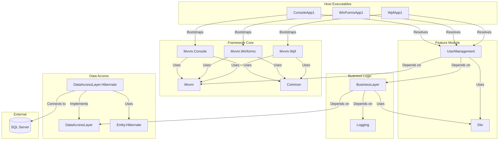

# User Management Application

## Overview

This repository implements a multi-host .NET desktop application for managing user accounts. It solves the problem of maintaining shared business logic across disparate Windows UI frameworks by enforcing a strict MVVM architecture with MEF (Managed Extensibility Framework) dependency injection.

The system is designed for developers who need to run the same user management workflow on WPF, WinForms, or in a headless console environment. The distinctive feature is its modularity: the core view models and business services are framework-agnostic, while specific "satellite" projects handle platform-specific rendering and messaging.

## Repository Description

A modular .NET solution demonstrating MEF-based dependency injection and MVVM patterns across WPF, WinForms, and Console hosts.

## Architecture Overview

The application follows a layered architecture where the presentation layer (WPF, WinForms, Console) is strictly decoupled from the data layer via the Business Layer. The core of the system is the `Mvvm` library, which defines the view model base classes and view interfaces. This allows the `UserManagement` module to define its business logic once, independent of the UI toolkit.

The flow of control begins at a host executable (`WpfApp1`, `WinFormsApp1`, or `ConsoleApp1`). These hosts use `CompositionHelper` from the `Common` project to build a MEF container. This container scans the application directory, discovers `IModuleController` implementations, and instantiates them. The `UserManagement` module provides the `UserViewModel`, which is injected into the host's main view.

Data persistence is handled by `BusinessLayer`, which depends on `DataAccessLayer` contracts and `DataAccessLayer.Hibernate` implementations. The `BusinessLayer` translates between UI DTOs and NHibernate entities. `Dto` provides the shared data contracts and validation rules used by both the UI and the business layer.

## Main Components

### `Mvvm`
The framework-agnostic core that defines the MVVM contract. It contains `ViewModelBase` and `MainViewModelBase`, which handle property change notification and lifecycle events. It also defines `IMessageService` and `IModuleController`, which allow view models to interact with the UI and the host to manage application lifecycle without knowing the specific toolkit. All host applications depend on this project.

### `UserManagement`
The primary feature module implementing the user management logic. It contains `UserViewModel`, which orchestrates `AddUserViewModel` and `ShowUsersViewModel`. These view models communicate via `WeakReferenceMessenger` and depend on `IUserService` from the business layer. This project is the only feature module in the solution and is resolved by all three hosts.

### `BusinessLayer`
The business logic layer that bridges the UI and data access. It contains `UserService`, which implements `IUserService` and handles the translation between `UserDto` and NHibernate `User` entities. It also contains the MEF wiring classes (`ModelContext`, `RepositoryFactory`) that configure the data access stack. This layer depends on `DataAccessLayer` contracts and `Dto`.

### `DataAccessLayer`
A contracts-only project that defines the persistence abstractions, such as `IRepository` and `IUnitOfWork`. It ensures that the `BusinessLayer` depends on stable interfaces rather than specific ORM technologies. It does not contain any executable logic.

### `DataAccessLayer.Hibernate`
The NHibernate implementation of the data access contracts. It contains `HibernateRepository` and `HibernateRepositoryFactory`, which use stateless sessions to perform reads and inserts. It also manages transactions via `HibernateUnitOfWork`. This project depends on `Entity.Hibernate` for the entity mappings.

### `Common`
A shared utility library providing cross-cutting concerns. Its most critical component is `CompositionHelper`, which builds the MEF container by scanning assemblies. It also provides `AssemblyHelper` for metadata retrieval and `BitmapSourceHelper` for image conversion in WPF. All host applications depend on this project for bootstrap logic.

### `Dto`
The shared data contract layer. It defines `IUser` and `UserDto` to ensure the UI and Business Layer communicate via stable data structures, not ORM entities. It also contains FluentValidation rules for user data validation.

## Features

- **Multi-Host Support**: The same user management logic runs on WPF, WinForms, and Console hosts.
- **MEF-Based Composition**: Uses Managed Extensibility Framework for dependency injection and module discovery.
- **Modular Architecture**: Separates framework-agnostic view models from platform-specific views and controllers.
- **NHibernate Persistence**: Uses stateless sessions for read and insert operations with automatic schema updates.
- **FluentValidation**: Integrates validation rules directly into the view models via `ValidatableViewModelBase`.
- **Serilog Logging**: Provides a simple logging interface backed by Serilog with file and debugger sinks.

## Technology Stack

- **.NET**: The base runtime for all applications.
- **WPF**: Windows Presentation Foundation for the primary desktop UI.
- **WinForms**: Windows Forms for the alternative desktop UI.
- **MEF (System.ComponentModel.Composition)**: Managed Extensibility Framework for dependency injection.
- **NHibernate / Fluent NHibernate**: ORM for data persistence.
- **CommunityToolkit.Mvvm**: Provides base classes for observable objects and commands.
- **FluentValidation**: For data model validation.
- **Serilog**: For structured logging.
- **MSTest**: For unit testing.

## Use Cases

- **WPF User Management**: A user opens the `WpfApp1` executable, views a list of users, and adds a new user via a form. The data is persisted to a SQL Server database.
- **WinForms User Management**: A user opens the `WinFormsApp1` executable and performs the same user management tasks using a Windows Forms interface.
- **Headless Data Seeding**: A developer runs `ConsoleApp1` to verify the MEF composition and data access layers without a UI, creating 100 test users in the database.
- **Unit Testing View Models**: A developer runs `TestProject1` to verify the validation and error handling logic of `AddUserViewModel` and `ShowUsersViewModel` using mocked services.

## Contents
- [BusinessLayer/](BusinessLayer.md)
- [Common/](Common.md)
- [ConsoleApp1/](ConsoleApp1.md)
- [DataAccessLayer/](DataAccessLayer.md)
- [DataAccessLayer.Hibernate/](DataAccessLayer.Hibernate.md)
- [Dto/](Dto.md)
- [Entity.Hibernate/](Entity.Hibernate.md)
- [Logging/](Logging.md)
- [Mvvm/](Mvvm.md)
- [Mvvm.Console/](Mvvm.Console.md)
- [Mvvm.Winforms/](Mvvm.Winforms.md)
- [Mvvm.Wpf/](Mvvm.Wpf.md)
- [TestProject1/](TestProject1.md)
- [UserManagement/](UserManagement.md)
- [WinFormsApp1/](WinFormsApp1.md)
- [WpfApp1/](WpfApp1.md)