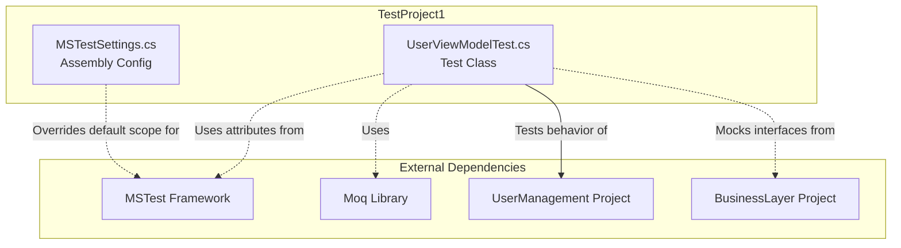

### Purpose

`TestProject1` is the sole unit test project in the repository. It provides automated verification for the user-management MVVM stack, specifically ensuring that `UserViewModel` correctly validates input, persists data via `IUserService`, and synchronizes state between child view models using `WeakReferenceMessenger`. The contents belong together because they define the testing environment, configuration, and logic required to isolate and validate the WPF-based view models without running the full application.

### Software Components

This directory contains C# source code structured around two main components:

*   **Test Suite:** The primary component is [UserViewModelTest](TestProject1/UserViewModelTest.md). This test class exercises the `UserViewModel` and its child components (`AddUserViewModel` and `ShowUsersViewModel`). It uses Moq to mock `IUserService` and `IMessageService`, allowing the tests to verify business logic (like saving users and fetching active lists) and UI state updates (like clearing fields and populating collections) without a running WPF window.
*   **Test Configuration:** The secondary component is [MSTestSettings.cs](TestProject1/MSTestSettings.md). This file configures the MSTest framework for the assembly, specifically setting the default parallelization scope for test execution.

### Relationships

The relationship between the two components is one of override. `MSTestSettings.cs` declares an assembly-level attribute to run test methods in parallel (`ExecutionScope.MethodLevel`). However, the `UserViewModelTest` class explicitly opts out of this behavior using the `[DoNotParallelize]` attribute. This ensures that all current tests run serially in a single process. This serial execution is necessary because the view models under test rely on `WeakReferenceMessenger`, a process-wide static singleton; running tests in parallel could cause state leaks between test cases (e.g., duplicate user entries in the collection).

Additionally, the test project depends on the `BusinessLayer` and `UserManagement` projects. The tests bypass the MEF (Managed Extensibility Framework) container used in the production app by directly assigning mocked dependencies to the view model properties. This allows the tests to run in a console-like environment despite targeting `net10.0-windows`, primarily to satisfy dependencies of the `MainViewModelBase` class.

### Rough edges

The assembly-level parallelization setting in `MSTestSettings.cs` is currently ineffective (dead configuration) because the only test class in the project, `UserViewModelTest`, explicitly disables parallel execution with `[DoNotParallelize]`. The setting would only become active if a new test class were added that does not opt out.

## Contents
- [MSTestSettings.cs](TestProject1/MSTestSettings.md)
- [UserViewModelTest.cs](TestProject1/UserViewModelTest.md)