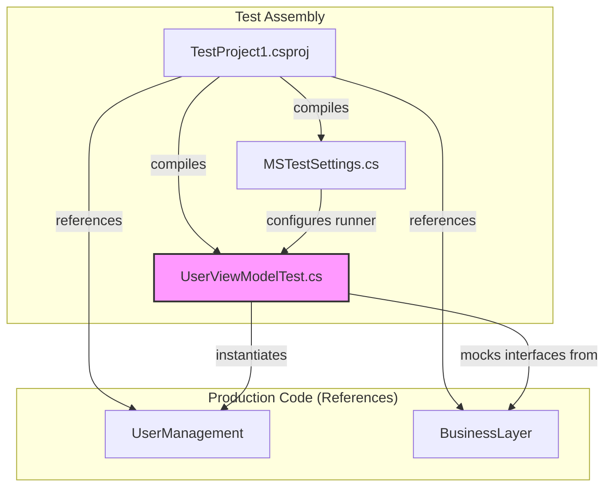

### Purpose

`TestProject1` is the unit test project for the solution, specifically validating the ViewModels within the `UserManagement` module. It exists to verify that user management logic—such as adding users with validation and loading user lists—behaves correctly without relying on a real database or UI dialogues. The contents belong together because they form a single MSTest assembly that targets the `UserViewModel` object graph, using Moq to mock external dependencies like `IUserService` and `IMessageService`.

### Software Components

The directory contains two source files that define the test execution environment and the test logic itself.

`UserViewModelTest.cs` is the primary component, containing the `UserViewModelTest` class. This class orchestrates the manual construction of `UserViewModel`, `AddUserViewModel`, and `ShowUsersViewModel`, bypassing the normal MEF composition. It uses Moq to stub out `IUserService` and `IMessageService`, allowing it to test specific behaviors such as input validation errors, successful user addition with state clearing, and error propagation when the service throws exceptions. The tests also verify the messaging contract via `WeakReferenceMessenger` to ensure that adding a user updates the active user list in `ShowUsersViewModel`.

`MSTestSettings.cs` is a configuration component that defines assembly-level test runner attributes. It sets the default parallelization scope for the test assembly.

### Relationships

The relationship between these files is one of configuration versus execution, though there is a notable conflict in their current intent. `TestProject1.csproj` defines the project structure, linking the source files to the MSTest and Moq libraries and referencing the production `BusinessLayer` and `UserManagement` projects.

`MSTestSettings.cs` applies an assembly-level `[Parallelize]` attribute, intending to allow test methods to run concurrently. However, `UserViewModelTest.cs` explicitly applies `[DoNotParallelize]` to its test class. This is a deliberate design choice to protect shared static state, specifically the `WeakReferenceMessenger.Default` instance, which is manipulated in the test teardown. Because the only test class in the assembly opts out of parallelization, the assembly-level setting in `MSTestSettings.cs` currently has no observable effect. The two files thus establish a tension: one enables a feature the other immediately disables.

### Rough edges

The assembly-level parallelization enabled in `MSTestSettings.cs` is currently inert because the sole test class in `UserViewModelTest.cs` explicitly disables it with `[DoNotParallelize]`. This creates ambiguity about the intended default policy for the project, as the configuration file suggests parallel execution while the only consumer prevents it.

## Contents
- [MSTestSettings.cs](TestProject1/MSTestSettings.md)
- [TestProject1.csproj](TestProject1/TestProject1.md)
- [UserViewModelTest.cs](TestProject1/UserViewModelTest.md)