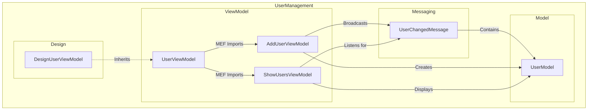

### Purpose

The `UserManagement` directory implements the MVVM architecture for a user management feature within a WPF application. It manages the lifecycle of user data display and creation, decoupling the UI from business logic through a strict layering of views, view models, and data models.

The contents belong together as a cohesive module: [UserManagement/ViewModel](UserManagement/ViewModel.md) contains the orchestration logic, [UserManagement/Model](UserManagement/Model.md) holds the display data structures, [UserManagement/Messaging](UserManagement/Messaging.md) defines the communication contract between components, and [UserManagement/Design](UserManagement/Design.md) provides stubs for visual editor support.

### Software Components

This module follows a standard MVVM pattern with clear separation between logic, data, and design support.

*   **View Models**: Located in [UserManagement/ViewModel](UserManagement/ViewModel.md), these classes handle business logic and UI state. `UserViewModel` acts as the module entry point, composing `AddUserViewModel` (for creating users) and `ShowUsersViewModel` (for listing users) via MEF.
*   **Data Models**: Found in [UserManagement/Model](UserManagement/Model.md), `UserModel` is a lightweight, observable object used for data binding. It exposes user properties like `FirstName` and `LastName` without containing business logic.
*   **Messaging Contracts**: Defined in [UserManagement/Messaging](UserManagement/Messaging.md), these files establish how components communicate. `UserChangedMessage` wraps `UserModel` data with a `UserChangeType` enum to notify listeners of state changes.
*   **Design Stubs**: Found in [UserManagement/Design](UserManagement/Design.md), these classes mirror the runtime view model hierarchy to provide sample data for the XAML designer. They exist only for design-time visualization and are ignored at runtime.

### Relationships

The components interact through a mix of dependency injection (MEF) and event messaging. The `UserViewModel` serves as the root, injecting `AddUserViewModel` and `ShowUsersViewModel` via `[Import]` attributes. This creates a hierarchical dependency where the parent composes the children.

Communication between the sibling view models is loose-coupled. `AddUserViewModel` broadcasts a `UserChangedMessage` via `WeakReferenceMessenger` after saving a user. `ShowUsersViewModel` listens for this message to update its list, avoiding a direct dependency on the add logic. Both view models depend on `IUserService` for persistence, while the design stubs depend on the runtime view models to provide preview data.

### Rough edges

*   **Unimplemented Message Handlers**: `ShowUsersViewModel` throws `NotImplementedException` for `Updated` and `Deleted` message types, meaning these operations will crash the application if triggered.
*   **Missing Identifier**: `UserModel` lacks an `Id` property, preventing the view model from correctly locating and modifying existing entries during update or delete operations.
*   **Manual Design Synchronization**: The design-time stubs in [UserManagement/Design](UserManagement/Design.md) are wired manually with `new` statements rather than reflecting the runtime MEF composition. This requires manual updates to the stubs whenever the runtime view model structure changes, leading to potential drift.

## Contents
- [Design/](UserManagement/Design.md)
- [Messaging/](UserManagement/Messaging.md)
- [Model/](UserManagement/Model.md)
- [ViewModel/](UserManagement/ViewModel.md)