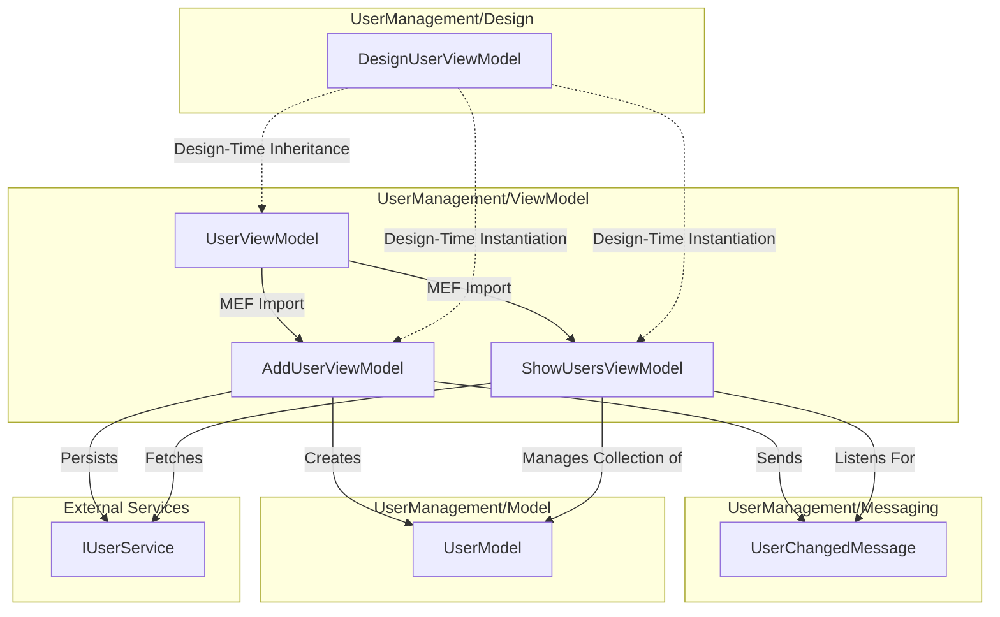

### Purpose

The `UserManagement` directory implements the WPF user management feature using the Model-View-ViewModel (MVVM) pattern and MEF for dependency injection. It groups the data model, presentation logic, inter-component messaging, and design-time helpers into a self-contained module that allows users to list and add new records. The contents belong together because they form a closed loop where the view models consume the model, communicate via defined messages, and rely on a shared composition root to wire everything together.

### Software Components

The directory is organized into four distinct layers of responsibility:

*   **Presentation Logic (`ViewModel/`):** This is the core of the module. It contains the root `UserViewModel` which acts as the MEF composition host, aggregating the child view models `AddUserViewModel` and `ShowUsersViewModel`. `AddUserViewModel` handles form validation and user creation, while `ShowUsersViewModel` manages the observable collection of users and reacts to change events.
*   **Data Model (`Model/`):** Contains `UserModel`, a lightweight observable class that serves as the binding target for the UI. It decouples the view from underlying service layer entities.
*   **Messaging Contract (`Messaging/`):** Defines `UserChangedMessage` and `UserChangeType`. These types facilitate loose coupling between sibling view models, allowing `AddUserViewModel` to notify `ShowUsersViewModel` of changes without direct reference.
*   **Design-Time Support (`Design/`):** Contains mock subclasses of the runtime view models. These are used exclusively by the WPF XAML designer to provide sample data, bypassing MEF which does not run in the design surface.

### Relationships

The architecture follows a strict dependency flow centered on MEF composition and event messaging. `UserViewModel` depends on the interfaces of the child view models, which MEF resolves at runtime. `AddUserViewModel` and `ShowUsersViewModel` both depend on `IUserService` for data persistence and retrieval, but they do not reference each other directly. Instead, `AddUserViewModel` sends a `UserChangedMessage` via `WeakReferenceMessenger` upon saving a new user, and `ShowUsersViewModel` listens for this message to update its `Users` collection.

The `Design` subdirectory exists outside the runtime flow. Its classes inherit from the runtime view models in `ViewModel/` but are only instantiated by the XAML designer via `d:DesignInstance` directives, ensuring the designer has data to render without triggering MEF or service calls.

### Rough edges

*   `UserModel` lacks an `Id` property, preventing `ShowUsersViewModel` from correctly handling `Updated` or `Deleted` messages, as it cannot identify which specific user to modify or remove.
*   `ShowUsersViewModel` throws a `NotImplementedException` for `Updated` and `Deleted` change types, meaning the current messaging contract is only partially implemented and will crash if those events are triggered.
*   `LoggingService` is injected into both `AddUserViewModel` and `ShowUsersViewModel` but is never used, representing dead code in the dependency graph.

## Contents
- [Design/](UserManagement/Design.md)
- [Messaging/](UserManagement/Messaging.md)
- [Model/](UserManagement/Model.md)
- [ViewModel/](UserManagement/ViewModel.md)