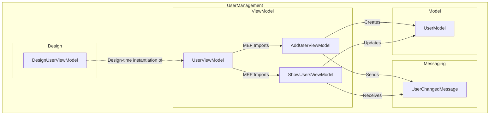

### Purpose

The `UserManagement` directory is a UI-framework-agnostic C# class library that implements the user management feature using the MVVM pattern. It provides the view models, data models, and messaging contracts required to display and manage users in Windows-based host applications. These components belong together because they form a self-contained feature module that can be consumed by multiple hosts (WPF, WinForms, Console) without exposing framework-specific dependencies.

### Software Components

The library is structured into four distinct layers, each with a specific responsibility:

*   **View Models (`ViewModel/`)**: The core logic layer. It contains the [UserViewModel](UserManagement/ViewModel/UserViewModel.md) (the root shell), [AddUserViewModel](UserManagement/ViewModel/AddUserViewModel.md) (for creating users), and [ShowUsersViewModel](UserManagement/ViewModel/ShowUsersViewModel.md) (for listing users). Each view model follows an interface-implementation pattern to support MEF-based dependency injection.
*   **Data Models (`Model/`)**: A lightweight data binding layer. It defines the [UserModel](UserManagement/Model/UserModel.md) class, which exposes observable properties for user details (First/Last Name) to the UI, keeping the view models decoupled from persistence entities.
*   **Messaging (`Messaging/`)**: The event contract layer. It defines [UserChangedMessage](UserManagement/Messaging/UserChangedMessage.md) and [UserChangeType](UserManagement/Messaging/UserChangeType.md), allowing view models to communicate state changes (like "User Added") via a messenger pattern without direct coupling.
*   **Design Stubs (`Design/`)**: Design-time support. This contains view model subclasses that populate the WPF XAML designer with hard-coded sample data, ensuring the UI renders visibly in editors where MEF composition is unavailable.

The project configuration in [UserManagement.csproj](UserManagement/UserManagement.md) ties these together, defining the .NET 10 Windows target and referencing external layers like `BusinessLayer` and `Mvvm`.

### Relationships

The components interact through a combination of MEF dependency injection and event messaging. `UserViewModel` acts as the composition root, importing `IAddUserViewModel` and `IShowUsersViewModel` from the MEF container. At runtime, these resolve to the concrete implementations in the same folder.

Communication between sibling view models is decoupled. When `AddUserViewModel` saves a user, it broadcasts a `UserChangedMessage` via `WeakReferenceMessenger`. `ShowUsersViewModel` subscribes to this message and updates its user collection in response. The `Design/` subdirectory mirrors this structure but replaces MEF injection with direct instantiation to feed the visual designer.

### Rough edges

The `ShowUsersViewModel` only handles `Added` user change events; `Updated` and `Deleted` events throw `NotImplementedException`, meaning the UI cannot currently reflect modifications or removals. Additionally, the `UserModel` lacks an `Id` property, which prevents the view model from uniquely identifying users to apply these future updates or deletions.

## Contents
- [UserManagement.csproj](UserManagement/UserManagement.md)
- [Design/](UserManagement/Design.md)
- [Messaging/](UserManagement/Messaging.md)
- [Model/](UserManagement/Model.md)
- [ViewModel/](UserManagement/ViewModel.md)