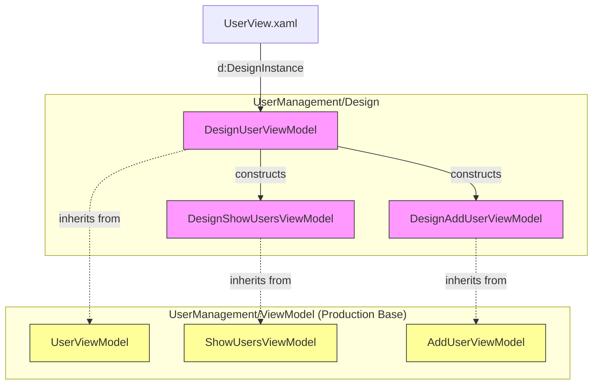

### Purpose

The `UserManagement/Design` directory contains view model subclasses that exist solely to support the WPF XAML designer. Because the designer cannot execute the application’s MEF (Managed Extensibility Framework) composition, it cannot populate the child view models of the main `UserViewModel` with real data. These classes provide hard-coded, sample data so that `UserView.xaml` renders with visible content in visual editors like Visual Studio or Blend, rather than appearing empty.

### Software Components

This directory contains three source code files, each acting as a "design-time" stub for a corresponding production view model located in `UserManagement/ViewModel/`. These are not runtime components; they are never instantiated by the running application.

*   **`DesignUserViewModel.cs`**: This is the root design-time model. It subclasses `UserViewModel` and overrides the constructor to manually instantiate its two child view models (`AddUserViewModel` and `ShowUsersViewModel`). In production, these children are injected via MEF; here, they are replaced with their design-time counterparts to ensure the view hierarchy is fully populated in the designer.
*   **`DesignAddUserViewModel.cs`**: This subclasses `AddUserViewModel`. Its only role is to pre-fill the `FirstName` and `LastName` properties with "Sample" and "User" so that the add-user form appears filled out in the designer preview.
*   **`DesignShowUsersViewModel.cs`**: This subclasses `ShowUsersViewModel`. Its constructor seeds the `Users` collection with three hard-coded demo users (Jane Doe, John Smith, Alice Johnson) so that the user list renders with sample rows.

### Relationships

The relationship between these components is strictly hierarchical and directional, mirroring the production view model tree but replacing MEF-injected dependencies with direct instantiations.

`UserView.xaml` references [DesignUserViewModel](UserManagement/Design/DesignUserViewModel.md) via `d:DesignInstance`. When the designer loads the view, it constructs `DesignUserViewModel`. This class then constructs [DesignShowUsersViewModel](UserManagement/Design/DesignShowUsersViewModel.md) and [DesignAddUserViewModel](UserManagement/Design/DesignAddUserViewModel.md).

Crucially, these design classes inherit from their production counterparts in `UserManagement/ViewModel/`. They do not redefine commands or bindings; they rely entirely on the base class behavior. The only difference is the constructor logic that injects fake data. Because they inherit from the production classes, they also inherit side effects like messenger subscriptions, though these are harmless in the designer context as no messages are dispatched.

### Rough edges

The design-time classes execute the real constructors of their base classes. This means that side effects present in the production constructors (such as registering message handlers in `ShowUsersViewModel`) are also triggered in the designer. While currently harmless because the designer does not dispatch these messages, this creates a coupling where changes to the production constructor's side effects could inadvertently affect the design-time behavior or cause unexpected interactions if the designer environment were ever to simulate message sending.

## Contents
- [DesignAddUserViewModel.cs](UserManagement/Design/DesignAddUserViewModel.md)
- [DesignShowUsersViewModel.cs](UserManagement/Design/DesignShowUsersViewModel.md)
- [DesignUserViewModel.cs](UserManagement/Design/DesignUserViewModel.md)