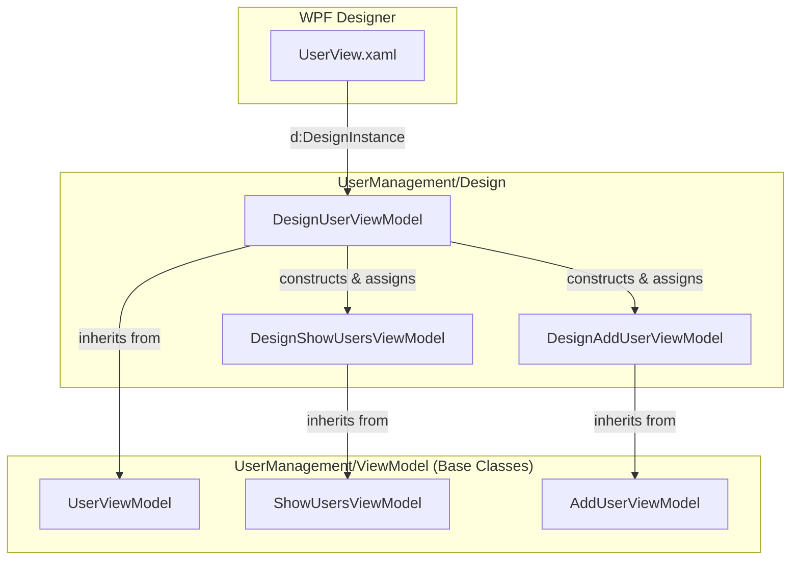

### Purpose

This directory contains design-time view models for the User Management module in a WPF application. Its sole responsibility is to provide sample data to the WPF XAML designer so that views like `UserView.xaml` render with populated fields instead of empty placeholders. These classes are never used at runtime; they exist exclusively to bridge the gap between MEF-based dependency injection (which cannot run in the designer) and the visual design surface.

### Software Components

The directory consists of three C# classes, each subclassing a corresponding runtime view model from `UserManagement/ViewModel/`. They are grouped by their role in the designer hierarchy:

*   **`DesignUserViewModel`** (`UserManagement/Design/DesignUserViewModel.cs`): This is the root design-time object. It subclasses the real `UserViewModel` and manually instantiates its two child view models in the constructor, bypassing MEF imports.
*   **`DesignShowUsersViewModel`** (`UserManagement/Design/DesignShowUsersViewModel.cs`): A subclass of `ShowUsersViewModel` that seeds the `Users` collection with three hard-coded `UserModel` entries (Jane Doe, John Smith, Alice Johnson).
*   **`DesignAddUserViewModel`** (`UserManagement/Design/DesignAddUserViewModel.cs`): A subclass of `AddUserViewModel` that pre-fills `FirstName` with "Sample" and `LastName` with "User" to demonstrate text input bindings.

All three classes rely on inheritance from the real view models to ensure XAML bindings resolve correctly. They override no methods; their logic is limited to constructor assignments that trigger the base class's observable property changes.

### Relationships

The dependency flow is strictly top-down from the designer entry point to the leaf view models. `UserView.xaml` references `DesignUserViewModel` via `d:DesignInstance`. When the designer instantiates `DesignUserViewModel`, its constructor creates instances of `DesignShowUsersViewModel` and `DesignAddUserViewModel` and assigns them to the inherited properties `ShowUsersViewModel` and `AddUserViewModel`, respectively.

This structure mirrors the runtime composition but replaces MEF `[Import]` resolution with direct `new` calls. Because the designer does not execute MEF, this manual wiring is necessary to populate the view. The base classes (`UserViewModel`, `ShowUsersViewModel`, `AddUserViewModel`) contain the actual business logic and service imports, but in the design-time context, those imports remain null or unresolvable, which is safe because the designer only needs to render the UI structure and sample data.

## Contents
- [DesignAddUserViewModel.cs](UserManagement/Design/DesignAddUserViewModel.md)
- [DesignShowUsersViewModel.cs](UserManagement/Design/DesignShowUsersViewModel.md)
- [DesignUserViewModel.cs](UserManagement/Design/DesignUserViewModel.md)