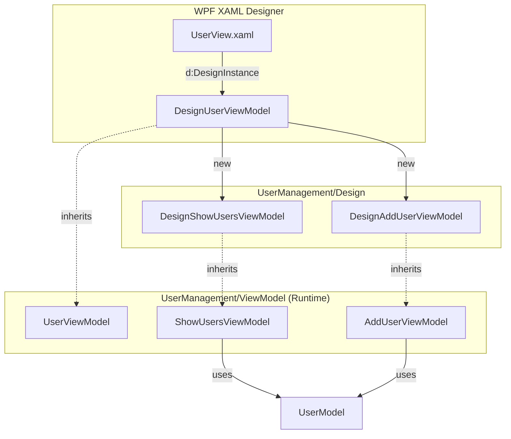

### Purpose

The `UserManagement/Design` directory contains design-time stubs for the WPF XAML designer. Its sole responsibility is to provide sample data to `UserView.xaml` when the project is open in Visual Studio, since the runtime dependency injection (MEF) services are not available in the designer environment.

These files belong together because they form a single, hand-maintained composition tree that mirrors the real `UserManagement/ViewModel` hierarchy. Without them, the designer would render a blank window instead of a populated user interface.

### Software Components

The directory consists of three C# classes, each a subclass of a corresponding runtime view model:

*   **[DesignUserViewModel](UserManagement/Design/DesignUserViewModel.md)**: The root of the design-time hierarchy. It extends the real `UserViewModel` and manually instantiates the two child view models (`ShowUsersViewModel` and `AddUserViewModel`) in its constructor, bypassing MEF.
*   **[DesignShowUsersViewModel](UserManagement/Design/DesignShowUsersViewModel.md)**: Extends `ShowUsersViewModel` to seed the `Users` collection with three hard-coded `UserModel` entries (Jane Doe, John Smith, Alice Johnson) so the data grid has content to render.
*   **[DesignAddUserViewModel](UserManagement/Design/DesignAddUserViewModel.md)**: Extends `AddUserViewModel` to pre-fill the `FirstName` and `LastName` properties with placeholder text ("Sample" and "User") so the form fields are not empty in the preview.

None of these classes participate in the running application. They are ignored during runtime composition and exist solely to satisfy the `d:DesignInstance` reference in `UserView.xaml`.

### Relationships

The components form a strict parent-child hierarchy that replicates the structure of the real `UserViewModel`. `DesignUserViewModel` is the entry point referenced by the XAML designer. It creates instances of `DesignShowUsersViewModel` and `DesignAddUserViewModel`, assigning them to the base class properties. This manual wiring replaces the MEF `[Import]` mechanism used at runtime.

The dependency direction is one-way: the design stubs depend on the runtime view models (`UserViewModel`, `ShowUsersViewModel`, `AddUserViewModel`) and the `UserModel` data class. The runtime view models have no knowledge of the design stubs. Because the design stubs hard-code the child types via `new`, any change to the runtime composition (e.g., swapping a view model type) will not automatically update the designer preview, requiring manual synchronization.

### Rough edges

The design-time composition is manually wired using `new` statements rather than mirroring the runtime MEF exports. This creates a second, parallel composition tree that must be updated manually whenever the runtime view model structure changes, leading to potential drift. Additionally, `DesignAddUserViewModel` is declared as `partial` without a corresponding partial definition, an inconsistency not shared by the other two stubs.

## Contents
- [DesignAddUserViewModel.cs](UserManagement/Design/DesignAddUserViewModel.md)
- [DesignShowUsersViewModel.cs](UserManagement/Design/DesignShowUsersViewModel.md)
- [DesignUserViewModel.cs](UserManagement/Design/DesignUserViewModel.md)