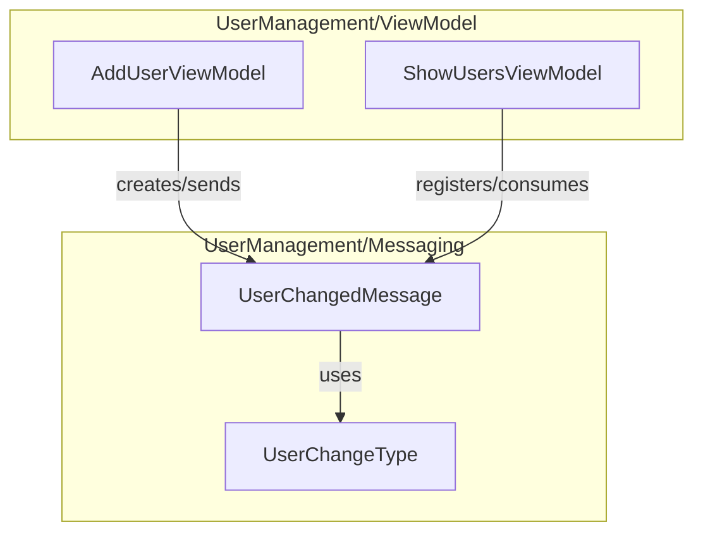

### Purpose

The `UserManagement/Messaging` directory defines the event contract for the UserManagement module. It contains the types required to announce user changes between view models without requiring them to reference each other directly. By isolating the message definition and the change classification here, the directory acts as a shared vocabulary for the communication layer, ensuring that senders and receivers agree on the structure of user state updates.

### Software Components

This directory consists of two tightly coupled source files that form the complete messaging payload:

*   **`UserChangeType.cs`**: Defines the [UserChangeType](UserManagement/Messaging/UserChangeType.md) enum. This classifies the nature of the event as `Added`, `Updated`, or `Deleted`. It serves as the discriminator field within the message, allowing recipients to apply specific logic based on what happened to the user.
*   **`UserChangedMessage.cs`**: Defines the [UserChangedMessage](UserManagement/Messaging/UserChangedMessage.md) class. This is the concrete message payload dispatched via `WeakReferenceMessenger`. It extends `ValueChangedMessage<UserModel>` from the CommunityToolkit.Mvvm library and includes a `UserChangeType` property to carry the classification alongside the user data.

### Relationships

The two files in this directory are interdependent; `UserChangedMessage` cannot exist without `UserChangeType`, as the latter is a required constructor parameter and property of the former. Together, they define the "what" of the communication. The "who" and "when" are handled outside this directory by the ViewModels. Specifically, `AddUserViewModel` (in `UserManagement/ViewModel/`) constructs and sends these messages, while `ShowUsersViewModel` (also in `UserManagement/ViewModel/`) registers for and consumes them. The dependency flows outward from this directory: the ViewModels depend on these types, but these types do not depend on the ViewModels.

### Rough edges

Currently, only the `Added` state of `UserChangeType` is fully implemented end-to-end. While the enum defines `Updated` and `Deleted`, and `UserChangedMessage` can carry them, the consuming `ShowUsersViewModel` throws a `NotImplementedException` for these cases. Consequently, these two enum values are part of the contract but effectively dead code, as sending them would crash the recipient.

## Contents
- [UserChangeType.cs](UserManagement/Messaging/UserChangeType.md)
- [UserChangedMessage.cs](UserManagement/Messaging/UserChangedMessage.md)