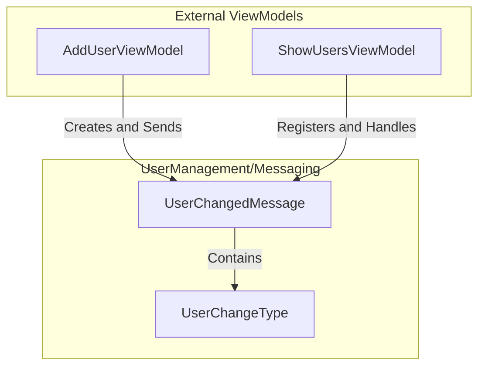

### Purpose

The `UserManagement/Messaging` directory defines the event contract for user changes within the module. It contains two files that work together to allow view models to communicate user state changes (add, update, delete) to other parts of the application without direct dependencies.

These files belong together because they form the minimal data structure required for this communication: the message payload and the enum that classifies the type of change.

### Software Components

The directory consists of two tightly coupled components:

- **`UserChangedMessage`** ([UserChangedMessage.cs](UserManagement/Messaging/UserChangedMessage.md)): This is the message class that travels through the system. It extends `ValueChangedMessage<UserModel>` from the CommunityToolkit.Mvvm library to carry a specific `UserModel` instance. It adds a `UserChangeType` property to specify what operation occurred. It provides two constructors: one that accepts both the type and the user, and a convenience constructor that defaults to `Added` if only a user is provided.
- **`UserChangeType`** ([UserChangeType.cs](UserManagement/Messaging/UserChangeType.md)): This enum defines the three possible operations: `Added`, `Updated`, and `Deleted`. It serves as the discriminator within the message, allowing recipients to determine how to handle the event.

### Relationships

The relationship between the two files is direct and mandatory. `UserChangedMessage` cannot exist or function without `UserChangeType`, as it uses the enum to define the nature of the event it carries.

External components interact with this directory as follows:
- **Senders**: `AddUserViewModel` creates an instance of `UserChangedMessage` with `UserChangeType.Added` and sends it via `WeakReferenceMessenger` after a successful user creation.
- **Receivers**: `ShowUsersViewModel` registers to listen for `UserChangedMessage`. It inspects the `UserChangeType` to decide how to update its UI. Currently, it only handles `Added` events, appending the new user to its collection. It throws a `NotImplementedException` for `Updated` and `Deleted` events.

### Rough edges

The `UserChangeType` enum defines `Updated` and `Deleted` states, but the current implementation does not support them end-to-end. `ShowUsersViewModel` explicitly throws an exception for these types, and no code currently sends them, meaning these enum values are effectively unused placeholders.

## Contents
- [UserChangeType.cs](UserManagement/Messaging/UserChangeType.md)
- [UserChangedMessage.cs](UserManagement/Messaging/UserChangedMessage.md)