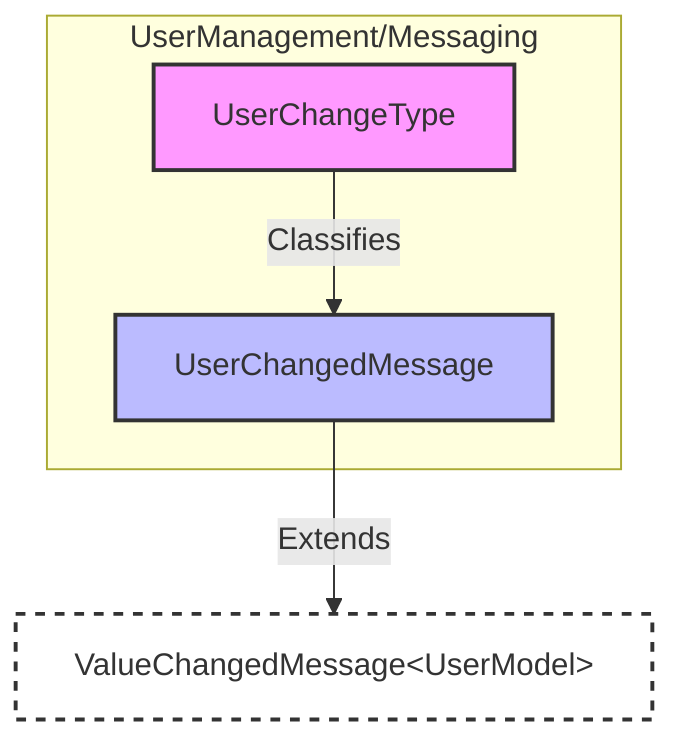

### Purpose

The `UserManagement/Messaging` directory contains the event contract for the UserManagement module. It defines the data structures required to notify other parts of the system when a user's state changes, enabling loose coupling between view models.

These two files belong together because they form a minimal, self-contained messaging protocol. [UserChangeType.cs](UserManagement/Messaging/UserChangeType.md) defines the *kind* of change (Added, Updated, Deleted), while [UserChangedMessage.cs](UserManagement/Messaging/UserChangedMessage.md) wraps that type with the actual user data. They act as the boundary that allows senders like `AddUserViewModel` to broadcast state changes without directly referencing receivers like `ShowUsersViewModel`.

### Software Components

This directory consists of two tightly coupled C# source files:

*   **`UserChangeType.cs`**: Defines the `UserChangeType` enum. This is a simple value type with three members: `Added`, `Updated`, and `Deleted`. It carries no logic and exists purely to classify the event.
*   **`UserChangedMessage.cs`**: Defines the `UserChangedMessage` class. This is a data carrier that extends `ValueChangedMessage<UserModel>` from the CommunityToolkit.Mvvm library. It holds a `UserModel` instance and a `UserChangeType`. It provides two constructors: a primary one that accepts both the type and the model, and a convenience constructor that defaults to `UserChangeType.Added`.

### Relationships

The dependency flow here is strictly one-way: `UserChangedMessage` depends on `UserChangeType`, but not vice versa. `UserChangedMessage` uses the enum to tag the payload, allowing receivers to switch on the change type.

Outside this directory, `AddUserViewModel` acts as the sender. It constructs a `UserChangedMessage` after saving a user and broadcasts it via `WeakReferenceMessenger`. `ShowUsersViewModel` acts as the receiver, registering for this message type to update its UI list. Note that currently, only the `Added` case is fully implemented in the receiver; `Updated` and `Deleted` are declared in the enum but will trigger a `NotImplementedException` if sent.

### Rough edges

The enum advertises support for `Updated` and `Deleted` changes, but the primary consumer (`ShowUsersViewModel`) does not implement handlers for them, throwing `NotImplementedException` if these messages are received.

## Contents
- [UserChangeType.cs](UserManagement/Messaging/UserChangeType.md)
- [UserChangedMessage.cs](UserManagement/Messaging/UserChangedMessage.md)