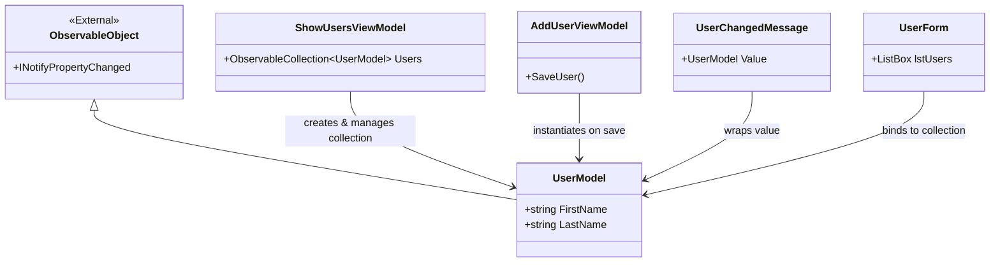

### Purpose

This directory holds the view-side data model for the UserManagement module. It contains `UserModel.cs`, which defines `UserModel`, a lightweight MVVM class used by the WPF UI for display and data binding.

The contents belong together because `UserModel` is the sole display object in this module. It decouples the UI layer from the underlying business logic entities and DTOs, allowing the view to bind directly to user properties without accessing storage or service layers.

### Software Components

The directory contains a single source file: `UserModel.cs`.

*   **`UserModel`**: A partial class that inherits from `ObservableObject` (via the `CommunityToolkit.Mvvm` library). It exposes `FirstName` and `LastName` as observable properties, enabling automatic UI updates when values change.

### Relationships

`UserModel` serves as the primary data carrier for the user interface in the UserManagement module. It does not contain business logic or persistence details; its sole purpose is to support WPF data binding.

The dependency flow is unidirectional: ViewModels and Views consume `UserModel`.
*   `ShowUsersViewModel` maintains an `ObservableCollection` of `UserModel` instances, populating it from `UserService` data.
*   `AddUserViewModel` constructs `UserModel` instances after saving new users and sends them via `UserChangedMessage`.
*   `UserChangedMessage` wraps a `UserModel` to propagate changes across the module.
*   `UserForm` binds its list control to the collection of `UserModel` objects.

Because `UserModel` lacks an `Id` property, the current implementation cannot distinguish between specific users when handling "Update" or "Delete" messages. This limits the module's ability to dynamically remove or modify individual items in the collection based on messages, as there is no key to match against.

## Contents
- [UserModel.cs](UserManagement/Model/UserModel.md)