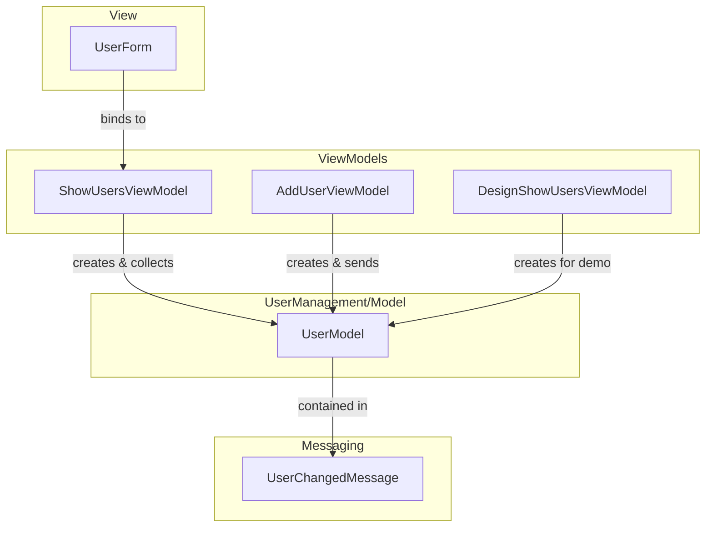

### Purpose

`UserManagement/Model` defines the view-model data structures for the UserManagement module. It contains the [UserModel](UserManagement/Model/UserModel.md) class, which serves as the primary data binding object for the UI layer. By separating display logic from persistence entities like `UserDto`, it ensures the UI remains decoupled from the backend storage details.

### Software Components

The directory holds a single source file, `UserModel.cs`. This file defines the [UserModel](UserManagement/Model/UserModel.md) class, which extends `ObservableObject` from CommunityToolkit.Mvvm. It exposes `FirstName` and `LastName` properties with change notifications, allowing bound UI controls to refresh automatically when values are updated. The class acts as a lightweight wrapper for user display data, holding no validation or business logic of its own.

### Relationships

`UserModel` is the central data contract for the UserManagement module's UI layer. The `ShowUsersViewModel` creates and maintains a collection of [UserModel](UserManagement/Model/UserModel.md) instances, mapping data from the `UserService` to populate the user list. When a new user is added via `AddUserViewModel`, a `UserChangedMessage` is raised containing a new [UserModel](UserManagement/Model/UserModel.md), triggering the update in `ShowUsersViewModel`. The `DesignShowUsersViewModel` also uses this class to provide static data for the XAML designer. Additionally, the WinForms `UserForm` binds directly to these models to display user names.

### Rough edges

The [UserModel](UserManagement/Model/UserModel.md) lacks an `Id` property, relying solely on names to identify users. This prevents the UI from correctly handling "Updated" or "Deleted" messages in `ShowUsersViewModel`, as there is no unique key to locate the specific row in the collection.

## Contents
- [UserModel.cs](UserManagement/Model/UserModel.md)