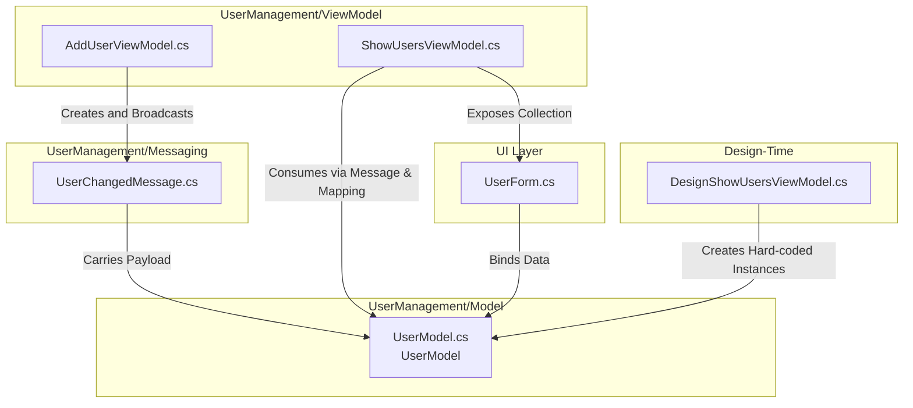

### Purpose

`UserManagement/Model` contains the view-side data objects for the UserManagement module. Its primary responsibility is to provide lightweight, observable models that allow the UI to display user data without depending on business logic or service DTOs. Currently, the directory holds a single class: [UserModel.cs](UserManagement/Model/UserModel.md). This class exists to bridge the gap between the UI layer and the underlying user entities, specifically for data binding in views and view models.

### Software Components

The directory consists of one source code component:

*   **`UserModel`**: Defined in [UserModel.cs](UserManagement/Model/UserModel.md), this is an observable object designed for data binding. It exposes `FirstName` and `LastName` properties and inherits from `ObservableObject` (via the `CommunityToolkit.Mvvm` library) to support change notifications. It serves two main roles: as a display item in user lists and as a payload for messaging events (e.g., `UserChangedMessage`). It contains no business logic, validation, or persistence logic.

### Relationships

`UserModel` is a leaf node in the dependency graph; it depends only on external MVVM toolkit classes and is consumed by various parts of the `UserManagement` module.

*   **Consumers**:
    *   `UserManagement/ViewModel/ShowUsersViewModel.cs` uses `UserModel` instances to populate its `Users` collection. It maps data from the business layer into `UserModel` objects for display.
    *   `UserManagement/ViewModel/AddUserViewModel.cs` creates a new `UserModel` after a successful save operation and broadcasts it via `UserChangedMessage`.
    *   `UserManagement/Messaging/UserChangedMessage.cs` carries `UserModel` instances as its payload.
    *   `UserManagement/Design/DesignShowUsersViewModel.cs` creates hard-coded `UserModel` instances for design-time preview.
    *   `WinFormsApp1/View/UserForm.cs` binds its UI controls to `ShowUsersViewModel.Users`, effectively displaying the `UserModel` data.

*   **Dependency Direction**: The dependency is strictly one-way. View models and views consume `UserModel`. No service or repository writes to `UserModel` directly; instead, data flows from the business layer into these models for presentation.

### Rough edges

`UserModel` lacks an `Id` property, meaning instances cannot be uniquely identified against persisted users. Consequently, `ShowUsersViewModel` cannot handle `Updated` or `Deleted` message types (currently throwing `NotImplementedException`) because it has no way to locate the specific existing entry to modify or remove.

## Contents
- [UserModel.cs](UserManagement/Model/UserModel.md)