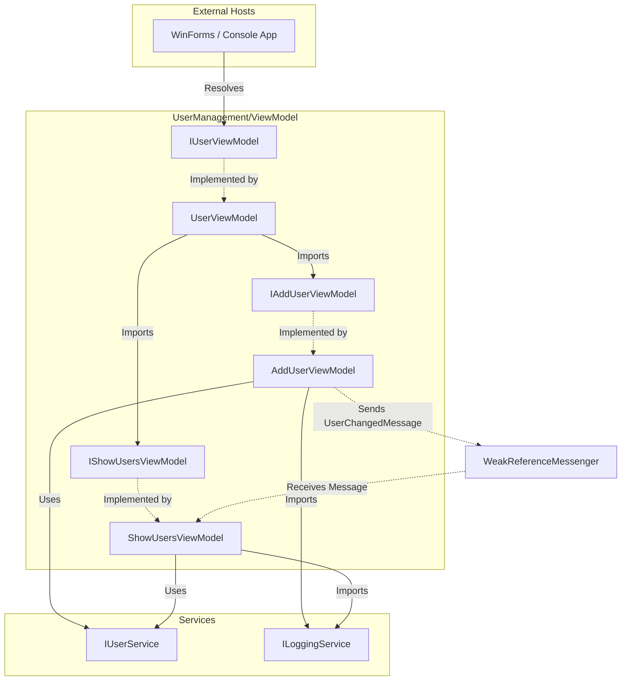

### Purpose

The `UserManagement/ViewModel` directory contains the MVVM layer for the User Management feature in a WPF application. It aggregates the logic for adding new users and displaying the user list into a single module entry point.

The components belong together because they form a closed loop of data flow: the "Add" view model validates and saves new users, while the "Show" view model displays them and listens for updates. The `UserViewModel` acts as the facade, composing these two siblings via MEF (Managed Extensibility Framework) so that the rest of the application can resolve the entire feature through a single contract.

### Software Components

The directory follows a strict interface/implementation pair pattern for each responsibility, allowing MEF to compose the objects without direct dependencies on concrete types.

**User Aggregation (`UserViewModel.cs` / `IUserViewModel.cs`)**
`UserViewModel` is the top-level entry point for the module. It implements `IUserViewModel` and `IMainViewModel`, serving as the root for the feature. It does not contain business logic; instead, it uses MEF `[Import]` attributes to inject the child view models (`IAddUserViewModel` and `IShowUsersViewModel`). This class is what external hosts (like the WinForms or Console apps) resolve to access the user management feature.

**User Creation (`AddUserViewModel.cs` / `IAddUserViewModel.cs`)**
`AddUserViewModel` handles the "create user" form. It manages the `FirstName` and `LastName` fields, provides live validation using `ValidatableViewModelBase`, and exposes `SaveUserCommand`. When a user is saved, it calls `IUserService.AddUser` and broadcasts a `UserChangedMessage` via `WeakReferenceMessenger` to notify other parts of the application. It inherits from `IUser` to allow direct data binding and validation against the user data shape.

**User Listing (`ShowUsersViewModel.cs` / `IShowUsersViewModel.cs`)**
`ShowUsersViewModel` manages the display of the user list. It holds an `ObservableCollection<UserModel>` and initializes it by calling `IUserService.GetActiveUsers` in `OnLoadedAsync`. Crucially, it subscribes to `UserChangedMessage` broadcasts from `AddUserViewModel` to keep the list in sync without direct references. It is the implementation half of the `IShowUsersViewModel` contract.

### Relationships

The directory relies on MEF for composition rather than direct instantiation. The dependency flow moves from the host application into `IUserViewModel`, which then resolves the two child contracts.

1.  **Composition Root:** External hosts resolve `IUserViewModel`. The MEF container finds `UserViewModel` (exported as `IUserViewModel`) and injects `AddUserViewModel` and `ShowUsersViewModel` into its `[Import]` properties.
2.  **Data Flow (Add -> Show):** There is no direct dependency between `AddUserViewModel` and `ShowUsersViewModel`. Instead, `AddUserViewModel` sends a `UserChangedMessage` to a global messenger (`WeakReferenceMessenger`) after a successful save. `ShowUsersViewModel` registers as a recipient in its constructor and updates its local `Users` collection when it receives the message. This decouples the two components.
3.  **Service Dependencies:** Both child view models import `IUserService` and `ILoggingService` from their respective layers (`BusinessLayer` and `Logging`). `IUserService` provides the actual persistence and retrieval logic.
4.  **UI Binding:** The WPF views (e.g., `UserView.xaml`) bind to the parent `UserViewModel` and navigate into the child properties (e.g., `{Binding AddUserViewModel.FirstName}`) to connect UI controls to the logic.

### Rough edges

-   **Unused Logging:** Both `AddUserViewModel` and `ShowUsersViewModel` import `ILoggingService` via MEF, but neither class actually invokes any logging methods. The dependency is declared but dead.
-   **Crash on Update/Delete:** `ShowUsersViewModel` handles `UserChangedMessage` by appending users, but its handlers for `Updated` and `Deleted` message types throw `NotImplementedException`. If these messages were ever sent, the application would crash.
-   **State Duplication Risk:** `ShowUsersViewModel.OnLoadedAsync` appends users to the collection rather than clearing it first. If the `Loaded` event were triggered twice (e.g., in a designer preview or re-navigation), the user list would contain duplicates.
-   **Validation Feedback Loop:** After a successful save in `AddUserViewModel`, the fields are cleared to empty strings. This immediately triggers validation errors ("required" fields), causing the form to display as invalid right after a successful action, until the user types again.

## Contents
- [AddUserViewModel.cs](UserManagement/ViewModel/AddUserViewModel.md)
- [IAddUserViewModel.cs](UserManagement/ViewModel/IAddUserViewModel.md)
- [IShowUsersViewModel.cs](UserManagement/ViewModel/IShowUsersViewModel.md)
- [IUserViewModel.cs](UserManagement/ViewModel/IUserViewModel.md)
- [ShowUsersViewModel.cs](UserManagement/ViewModel/ShowUsersViewModel.md)
- [UserViewModel.cs](UserManagement/ViewModel/UserViewModel.md)