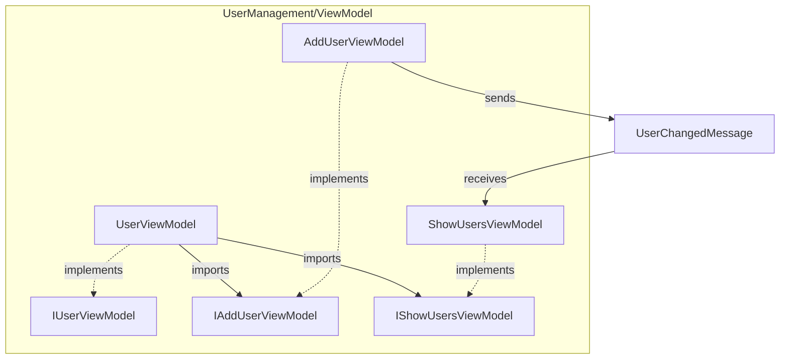

### Purpose

The `UserManagement/ViewModel` directory serves as the presentation-layer logic for the User Management feature, implementing the Model-View-ViewModel (MVVM) pattern via MEF (Managed Extensibility Framework). It groups the view models responsible for creating and listing users, alongside their contracts and a root composition host. These components belong together because they form a single, self-contained view-model hierarchy: the root view model aggregates the specific "add" and "show" functionalities, and MEF injects the concrete implementations into the parent based on their interface definitions.

### Software Components

The directory contains three distinct logical components, each defined by an interface-concrete class pair:

1.  **Root Composition Host:**
    *   **Files:** [IUserViewModel.cs](UserManagement/ViewModel/IUserViewModel.md) and [UserViewModel.cs](UserManagement/ViewModel/UserViewModel.md)
    *   **Role:** The entry point for the module. `UserViewModel` inherits from `MainViewModelBase` and uses MEF `[Import]` to aggregate the other two view models. It is exported as both `IUserViewModel` and `IMainViewModel`, allowing different hosts (console, WPF, WinForms) to resolve the entire feature through a single object. It contains no business logic itself.

2.  **Add User Functionality:**
    *   **Files:** [IAddUserViewModel.cs](UserManagement/ViewModel/IAddUserViewModel.md) and [AddUserViewModel.cs](UserManagement/ViewModel/AddUserViewModel.md)
    *   **Role:** Handles the creation of new users. `AddUserViewModel` implements `INotifyDataErrorInfo` via `ValidatableViewModelBase` to provide live validation. It exposes `FirstName` and `LastName` properties (satisfying `IUser`) and a `SaveUserCommand`. Upon saving, it persists the user via `IUserService` and broadcasts a `UserChangedMessage` to notify other parts of the application.

3.  **Show Users Functionality:**
    *   **Files:** [IShowUsersViewModel.cs](UserManagement/ViewModel/IShowUsersViewModel.md) and [ShowUsersViewModel.cs](UserManagement/ViewModel/ShowUsersViewModel.md)
    *   **Role:** Manages the display of existing users. `ShowUsersViewModel` maintains an `ObservableCollection<UserModel>` exposed as `Users`. It initializes this collection by fetching data via `IUserService.GetActiveUsers()` when `LoadedCommand` is invoked. It also subscribes to `WeakReferenceMessenger` to update the list reactively when a `UserChangedMessage` is received.

### Relationships

The directory relies on a strict MEF-based composition pattern. `UserViewModel` is the parent container; it does not instantiate `AddUserViewModel` or `ShowUsersViewModel` directly. Instead, MEF resolves their respective interfaces (`IAddUserViewModel`, `IShowUsersViewModel`) and injects them into the `[Import]` properties of `UserViewModel`. This decouples the parent from the concrete implementations, allowing the components to be swapped or tested in isolation.

Data flows primarily through the business layer (`IUserService`) and message broadcasting. While `AddUserViewModel` writes to the database, it does not directly modify `ShowUsersViewModel`. Instead, it sends a `UserChangedMessage` via `WeakReferenceMessenger`. `ShowUsersViewModel` listens for this message and appends the new user to its local `Users` collection. This asynchronous messaging decouples the two sibling view models, ensuring the list view stays in sync without tight coupling.

### Rough edges

- `LoggingService` is injected into both `AddUserViewModel` and `ShowUsersViewModel` but is never actually used in their method bodies, representing dead code.
- `ShowUsersViewModel`'s message handler throws `NotImplementedException` for `Updated` and `Deleted` change types. Since these are not currently sent, the application works, but any future implementation of edit/delete features will cause a runtime crash rather than graceful handling.
- `UserViewModel` initializes its imported properties with `null!`. If MEF fails to resolve an export, the error surfaces as a `NullReferenceException` later in the code rather than a clear composition failure at startup.

## Contents
- [AddUserViewModel.cs](UserManagement/ViewModel/AddUserViewModel.md)
- [IAddUserViewModel.cs](UserManagement/ViewModel/IAddUserViewModel.md)
- [IShowUsersViewModel.cs](UserManagement/ViewModel/IShowUsersViewModel.md)
- [IUserViewModel.cs](UserManagement/ViewModel/IUserViewModel.md)
- [ShowUsersViewModel.cs](UserManagement/ViewModel/ShowUsersViewModel.md)
- [UserViewModel.cs](UserManagement/ViewModel/UserViewModel.md)