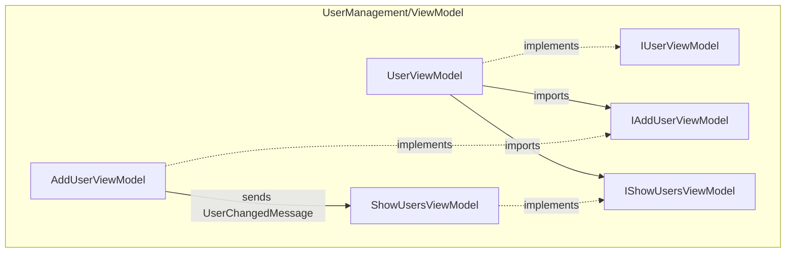

### Purpose

The `UserManagement/ViewModel` directory contains the MVVM layer for the user management feature. It defines the view models that manage state and logic for adding users and displaying the user list, as well as the top-level shell that composes them.

The files belong together because they implement a strict "interface + implementation" pattern for each logical view. Each concrete view model is exported to the MEF composition container via interfaces defined in the same folder. This allows the application hosts (WPF, WinForms, Console) to bind to stable contracts rather than concrete classes, while enabling MEF to inject dependencies like `IUserService` automatically.

### Software Components

The directory is divided into three functional pairs, plus a top-level aggregate:

*   **The Add User View**: Composed of [IAddUserViewModel.cs](UserManagement/ViewModel/IAddUserViewModel.md) and its implementation [AddUserViewModel.cs](UserManagement/ViewModel/AddUserViewModel.md). This component handles the form state for creating a new user. It extends `IUser` to directly expose `FirstName` and `LastName` properties, handles validation via `INotifyDataErrorInfo`, and executes the save logic through `SaveUserAsync`.
*   **The Show Users View**: Composed of [IShowUsersViewModel.cs](UserManagement/ViewModel/IShowUsersViewModel.md) and [ShowUsersViewModel.cs](UserManagement/ViewModel/ShowUsersViewModel.md). This component maintains the `ObservableCollection` of users displayed in the UI. It fetches data from the business layer on load and listens for `UserChangedMessage` events to update the list reactively when a new user is added.
*   **The Root Shell**: Composed of [IUserViewModel.cs](UserManagement/ViewModel/IUserViewModel.md) and [UserViewModel.cs](UserManagement/ViewModel/UserViewModel.md). This is the composition root for the feature. It exposes the two child view models above as read-only properties. It does not contain feature logic itself but acts as the single entry point for the application hosts, inheriting from `MainViewModelBase` to provide standard window lifecycle handling.

### Relationships

The components are linked through MEF composition attributes (`[Export]` and `[Import]`) and dependency injection. `UserViewModel` imports the interfaces `IAddUserViewModel` and `IShowUsersViewModel`. At runtime, the MEF container resolves these to the concrete `AddUserViewModel` and `ShowUsersViewModel` classes in the same folder.

Communication between the sibling view models occurs via `WeakReferenceMessenger`. When `AddUserViewModel` successfully saves a user, it broadcasts a `UserChangedMessage`. `ShowUsersViewModel` registers as a recipient for this message and appends the new user to its list, ensuring the UI stays in sync without direct references between the two classes.

### Rough edges

`ShowUsersViewModel` registers for `UserChangedMessage` but only handles the `Added` event type. Handlers for `Updated` and `Deleted` currently throw `NotImplementedException`, meaning the user list will not reflect changes or removals if those message types are ever sent. Additionally, the `OnLoadedAsync` method in `ShowUsersViewModel` appends to the `Users` collection without clearing it first, which would result in duplicate entries if the load command is executed multiple times.

## Contents
- [AddUserViewModel.cs](UserManagement/ViewModel/AddUserViewModel.md)
- [IAddUserViewModel.cs](UserManagement/ViewModel/IAddUserViewModel.md)
- [IShowUsersViewModel.cs](UserManagement/ViewModel/IShowUsersViewModel.md)
- [IUserViewModel.cs](UserManagement/ViewModel/IUserViewModel.md)
- [ShowUsersViewModel.cs](UserManagement/ViewModel/ShowUsersViewModel.md)
- [UserViewModel.cs](UserManagement/ViewModel/UserViewModel.md)