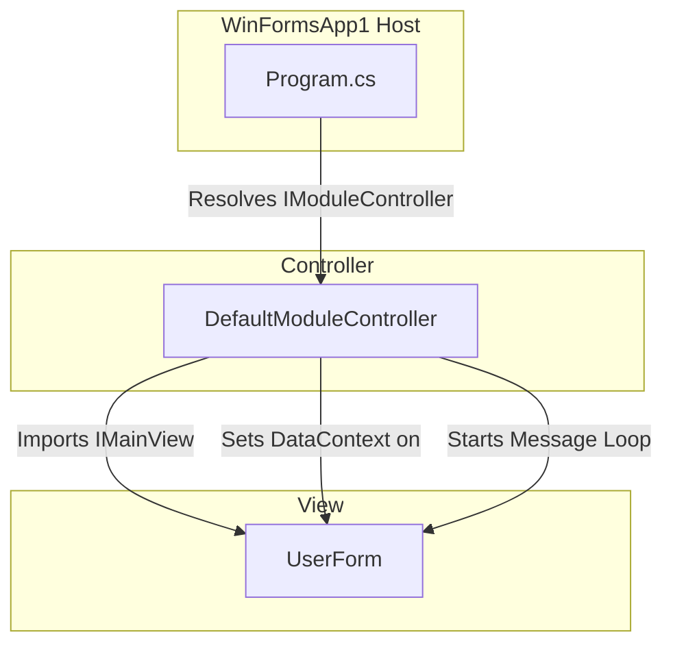

### Purpose

`WinFormsApp1` is the WinForms executable host for the user management application. It is responsible for starting the process, resolving application modules via MEF, and managing the WinForms message loop, while delegating actual business logic and UI rendering to its child components. The directory contains the entry point, runtime configuration, and the specific View and Controller implementations that adapt the shared MVVM architecture to the Windows Forms platform.

### Software Components

The source code in this project is organized into three functional areas: the host infrastructure, the module controller, and the user interface.

*   **Host Infrastructure**: Located in `Program.cs`, this component serves as the application's entry point. It initializes the MEF composition container, registers global exception handlers, and discovers `IModuleController` exports. It does not contain business logic but orchestrates the startup sequence by calling `Initialize()` and `Run()` on discovered modules.
*   **Module Controller**: The `Controller/` subdirectory contains `DefaultModuleController`. This class acts as the bridge between the host and the MVVM layers. It implements `IModuleController`, imports the main view and view model, wires the view model to the view's `DataContext`, and starts the WinForms message loop.
*   **User Interface**: The `View/` subdirectory contains `UserForm`, the application's primary window. It is split across `UserForm.cs` (hand-written binding logic) and `UserForm.Designer.cs` (auto-generated layout). The form implements `IMainView` and is exported via MEF, allowing the controller to instantiate it without hard-coded references.

### Relationships

The components in `WinFormsApp1` rely on a clear separation between the host process, the module lifecycle, and the UI presentation. `Program.cs` does not know about `UserForm` or `DefaultModuleController` by name; it only interacts with the `IModuleController` interface.

1.  **Startup Chain**: `Program.Main` uses `CompositionHelper` to build a container that scans loaded assemblies. It resolves all `IModuleController` exports. In this project, that resolution yields `DefaultModuleController`.
2.  **View-ViewModel Wiring**: `DefaultModuleController` receives `IMainView` (which is `UserForm`) and `IMainViewModel` (which is `UserViewModel`) via MEF imports. Upon construction, it assigns the view model to the view.
3.  **Execution Loop**: `DefaultModuleController.Run()` calls `Application.Run` on the `UserForm`. This blocks the main thread until the form is closed. `UserForm` binds its controls to properties on the view model, handling data display and user input for adding users.
4.  **Configuration**: [App.config](WinFormsApp1/App.md) provides the `ConnectionString` required by the business layer. Although `Program.cs` does not read this directly, the MEF container constructs the business layer objects (like `ModelContext`) which read this setting during startup.

### Rough edges

*   **Hard Casts in Controller**: `DefaultModuleController.Run()` casts the `IMainView` to `Form`. This will throw a runtime exception if a non-`Form` implementation of `IMainView` is ever injected.
*   **Single Module Limitation**: `Program.cs` iterates through modules in two separate loops (initialize, then run). Because `DefaultModuleController.Run()` blocks the thread, any subsequent modules in the list would never execute their `Run()` method.
*   **Missing Shutdown**: The `IModuleController.Shutdown()` method is defined but never called by `Program.cs`, preventing clean teardown of modules from the host.
*   **Default UI Text**: The `UserForm` title remains the designer default "Form1" rather than a descriptive name.

## Contents
- [App.config](WinFormsApp1/App.md)
- [Program.cs](WinFormsApp1/Program.md)
- [Controller/](WinFormsApp1/Controller.md)
- [View/](WinFormsApp1/View.md)