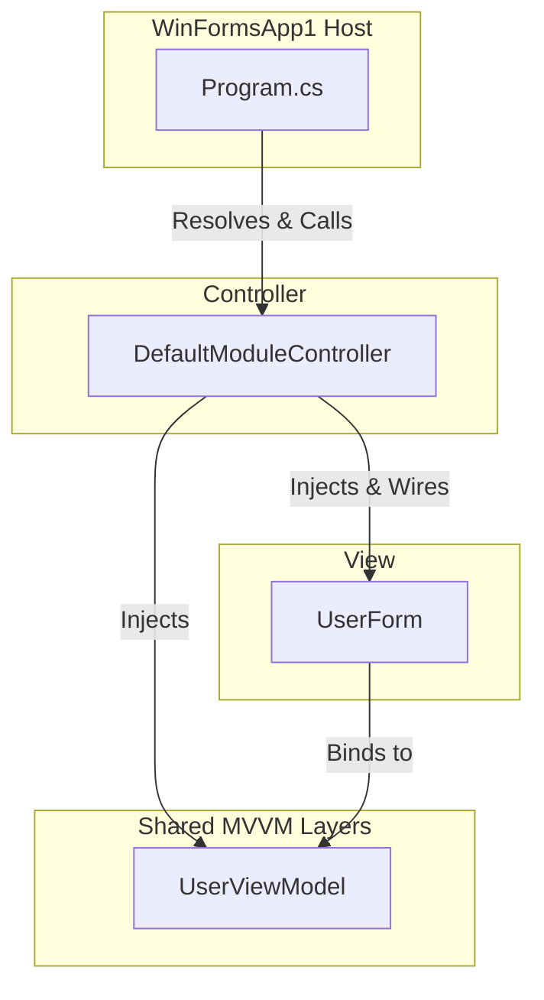

### Purpose

`WinFormsApp1` is the WinForms host executable for the user management application. It provides the Windows desktop interface where users view current accounts and add new ones. The directory contains the entry point, the main window, and the module controller that connects the host process to the shared MVVM architecture. These components belong together because they form the specific platform implementation (WinForms) of the application’s UI layer, distinct from the shared business and data layers.

### Software Components

The application logic in this project is distributed across three main components:

*   **Entry Point:** [Program.cs](WinFormsApp1/Program.md) contains the `Main` method. It initializes the MEF composition container, resolves all `IModuleController` implementations, and manages the application lifecycle (initialization, running, and exit codes).
*   **Module Controller:** The [Controller/](WinFormsApp1/Controller.md) directory holds `DefaultModuleController`, the sole implementation of `IModuleController`. This class wires the view model to the view and hosts the WinForms message loop. It acts as the bridge between the host process and the MVVM layers.
*   **Main View:** The [View/](WinFormsApp1/View.md) directory contains `UserForm`, the single main window. This partial class implements `IMainView`, handles data binding for the user list and input fields, and forwards user actions to the view model.

Additionally, [App.config](WinFormsApp1/App.md) provides the SQL Server connection string required by the underlying data access layer, though it is not read directly by the code in this directory.

### Relationships

The flow of control begins in `Program.cs`, which uses MEF to discover and instantiate `DefaultModuleController` from the `Controller/` directory. The controller, in turn, injects `UserForm` (from `View/`) and the shared `UserViewModel` into its constructor.

The wiring is imperative: `DefaultModuleController` assigns the view model to the form’s `DataContext`, which triggers the form’s binding logic to connect UI controls to the view model’s properties. Once wired, the controller calls `Application.Run` on `UserForm`, blocking the thread until the user closes the window.

The dependency direction is strict:
1.  `Program.cs` depends on `DefaultModuleController` (via MEF resolution).
2.  `DefaultModuleController` depends on `UserForm` and `UserViewModel`.
3.  `UserForm` depends on `UserViewModel` for state and commands.

The `App.config` file is consumed transitively by the `BusinessLayer` and `DataAccessLayer` projects, not by `WinFormsApp1` directly.

### Rough edges

*   `IModuleController.Shutdown()` is defined in the contract but never called by `Program.cs`; the application exits immediately when the main form closes, leaving cleanup hooks unreachable.
*   The error dialog in `Program.cs` displays text in German, while other user-facing messages are in English, resulting in inconsistent localization.
*   `UserForm` is titled "Form1" in the UI, which appears to be an oversight from the initial design generation.

## Contents
- [App.config](WinFormsApp1/App.md)
- [Program.cs](WinFormsApp1/Program.md)
- [Controller/](WinFormsApp1/Controller.md)
- [View/](WinFormsApp1/View.md)