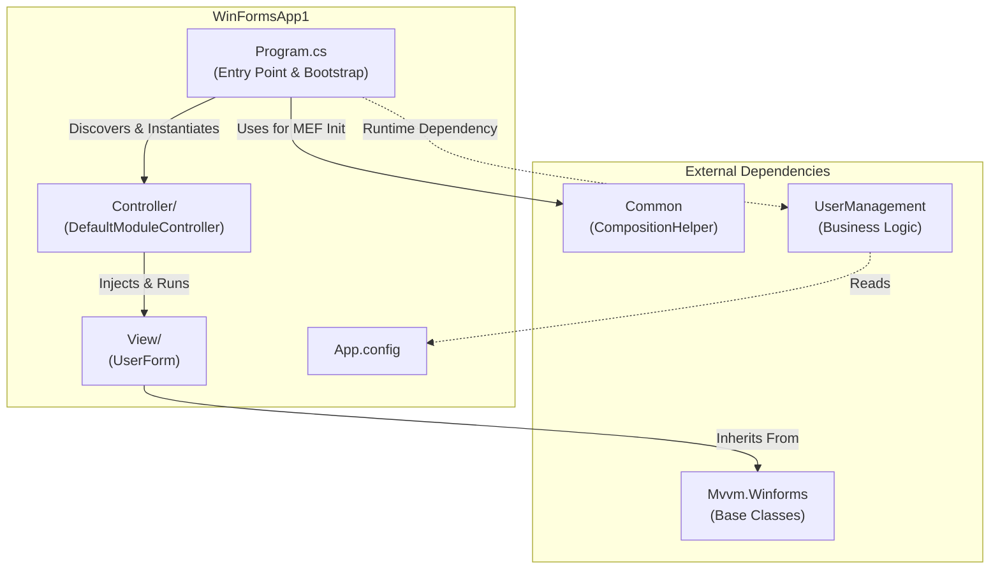

### Purpose

The `WinFormsApp1` directory serves as the Windows Forms host application for the user management solution. Its primary responsibility is to bootstrap the application, discover feature modules via MEF (Managed Extensibility Framework), and manage their lifecycle. The contents belong together because they form the executable entry point and the specific UI adapter required to run the generic business logic within the WinForms environment, distinct from the solution's other hosts (WPF and Console).

### Software Components

The source code in this project is organized into three distinct layers of responsibility:

*   **Entry Point & Bootstrap**: Located in `Program.cs`, the `Program` class handles the static `Main` entry point. It initializes the WinForms application, sets up global unhandled exception handling, and builds the MEF composition container. It is responsible for discovering `IModuleController` implementations and orchestrating their `Initialize` and `Run` lifecycle.
*   **Module Controller**: Found in the `Controller` subdirectory, `DefaultModuleController` is the concrete implementation of `IModuleController`. It acts as the bridge between the generic application bootstrap and the specific WinForms UI, handling the actual startup of the message loop.
*   **User Interface**: Located in the `View` subdirectory, `UserForm` is the main visual component. It consists of partial class files (`UserForm.cs`, `UserForm.Designer.cs`) and resources (`UserForm.resx`) that define the layout, data bindings, and validation logic for viewing and adding users.

### Relationships

The dependency flow in `WinFormsApp1` is strictly top-down, starting from the executable bootstrap and moving toward the UI.

`Program.cs` initiates the process by calling `CompositionHelper` (from the `Common` project) to create the MEF container. It then uses this container to locate and instantiate `DefaultModuleController`. This controller, in turn, receives the `UserForm` and its associated ViewModel via dependency injection. Finally, the controller calls `Run()`, which starts the `UserForm` message loop.

The `WinFormsApp1.csproj` file defines the project structure, referencing `Common`, `Mvvm.Winforms`, and `UserManagement`. These references are critical not just for compilation, but for runtime MEF discovery, as `CompositionHelper` scans the output directory for assemblies containing exports.

Additionally, `App.config` provides the database connection string. While `Program.cs` does not read it directly, it is consumed by the `UserManagement` modules (via `ModelContext`) that are loaded into the application at runtime.

### Rough edges

*   **Uncalled Shutdown**: The `IModuleController` interface defines a `Shutdown()` method, and `DefaultModuleController` implements it. However, `Program.cs` never calls this method, leaving the module without a clean shutdown path from the host.
*   **Inconsistent Localization**: The unhandled exception dialog in `Program.cs` uses German text ("Es ist ein Fehler aufgetreten."), while the "No module found" dialog in the same file uses English.
*   **Hardcoded Configuration**: The connection string in `App.config` is hardcoded to `localhost`. This value is duplicated verbatim in the `WpfApp1` and `ConsoleApp1` configuration files, meaning environment changes require editing multiple files manually.

## Contents
- [App.config](WinFormsApp1/App.md)
- [Program.cs](WinFormsApp1/Program.md)
- [WinFormsApp1.csproj](WinFormsApp1/WinFormsApp1.md)
- [Controller/](WinFormsApp1/Controller.md)
- [View/](WinFormsApp1/View.md)