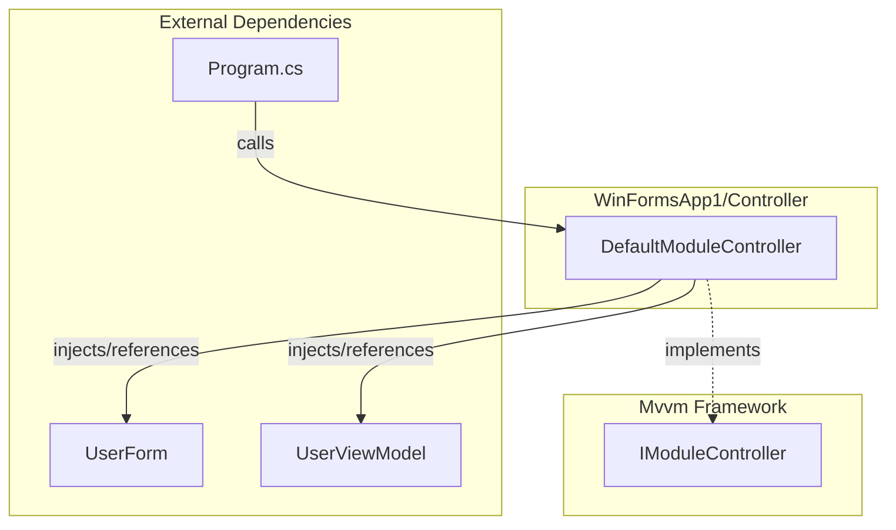

### Purpose

This directory serves as the WinForms host adapter for the application. It contains the single controller that bridges the generic Mvvm framework with the specific WinForms user interface. Its sole responsibility is to manage the application lifecycle within this specific UI technology, allowing `Program.cs` to treat the WinForms host as a swappable module.

### Software Components

The directory contains one primary component:

*   **`DefaultModuleController.cs`**: This is the concrete implementation of the `IModuleController` interface. It is exported via MEF so that the application entry point can discover and instantiate it. This class acts as the glue between the abstract framework interfaces and the concrete WinForms types (`UserForm` and `UserViewModel`). It handles the initialization, execution, and theoretical shutdown of the WinForms application loop.

### Relationships

`DefaultModuleController` depends heavily on the `Mvvm` framework project. It implements `IModuleController`, which dictates the `Initialize`, `Run`, and `Shutdown` lifecycle methods. It receives `UserForm` and `UserViewModel` via constructor injection, relying on their `[Export]` attributes to satisfy the interface contracts defined in `Mvvm`.

The dependency direction is strictly one-way: `Program.cs` calls into this controller, which in turn calls into the View and ViewModel. The controller does not define the logic for the form or the data; it merely orchestrates their presentation and lifetime. Because this directory contains only one file with no internal sub-components, the "relationship" is primarily external: this file is the isolated point of contact between the generic `Program` entry point and the specific WinForms implementation.

### Rough edges

*   `DefaultModuleController` contains a `Shutdown()` method that is never called by `Program.cs`, making it dead code in this specific host context.
*   The `Run()` method performs a hard cast of `MainView` to `Form`, which assumes the concrete implementation is always a WinForms `Form` and will throw an exception if the injected view does not inherit from it.

## Contents
- [DefaultModuleController.cs](WinFormsApp1/Controller/DefaultModuleController.md)