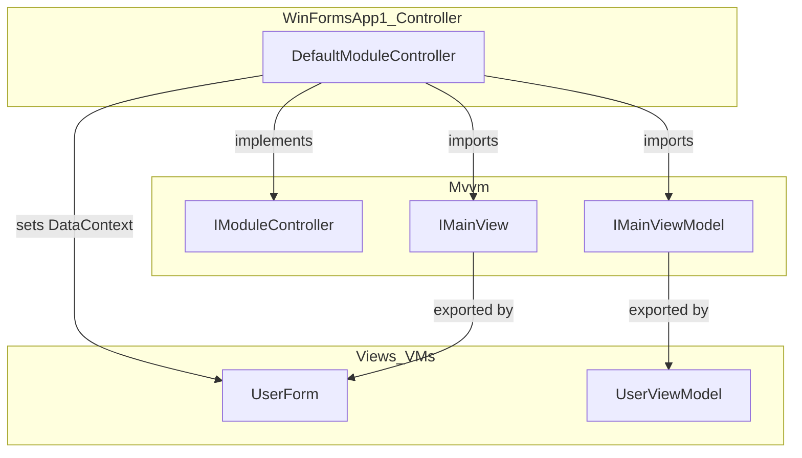

### Purpose

The `WinFormsApp1/Controller` directory contains the application's module controller, which acts as the bridge between the WinForms host and the MVVM architecture. It holds a single source file that implements the `IModuleController` lifecycle contract, allowing the shared `Mvvm` project to discover and drive the application's startup and shutdown via MEF.

### Software Components

The directory consists of a single component:

*   **`DefaultModuleController`**: Located in `DefaultModuleController.cs`, this class is the sole `IModuleController` implementation in the project. It is responsible for composing the main view (`UserForm`) and view model (`UserViewModel`) and managing the application's execution loop. For more detailed class documentation, see [DefaultModuleController](WinFormsApp1/Controller/DefaultModuleController.md).

### Relationships

`DefaultModuleController` sits at the intersection of the application host and the MVVM layers. It does not contain business logic itself but orchestrates the components that do.

*   **MEF Composition**: `Program.Main` uses MEF to locate `DefaultModuleController` by its `IModuleController` export. The controller's constructor accepts `IMainView<DialogResult, int>` and `IMainViewModel` as imports.
*   **View-ViewModel Wiring**: Upon construction, the controller assigns the `MainViewModel` to the `MainView`'s `DataContext`. This triggers the `UserForm` to set up its data bindings.
*   **Lifecycle Management**: The controller's `Run()` method starts the WinForms message loop by calling `Application.Run` on the main form, blocking until the application exits.

### Rough edges

*   The `Run()` method contains a hard cast of `MainView` to `Form`. This is safe only because `UserForm` is the current sole implementation of `IMainView<DialogResult, int>`; adding a non-Form implementation would cause a runtime exception.
*   The `Shutdown()` method is defined but never called by `Program.Main`, making the controller-level shutdown path currently dead code in this host.
*   The view model's `CloseWindow()` and `Shutdown(int)` methods are never invoked by the controller, preventing the view model from signaling a specific exit code back to the host.

## Contents
- [DefaultModuleController.cs](WinFormsApp1/Controller/DefaultModuleController.md)