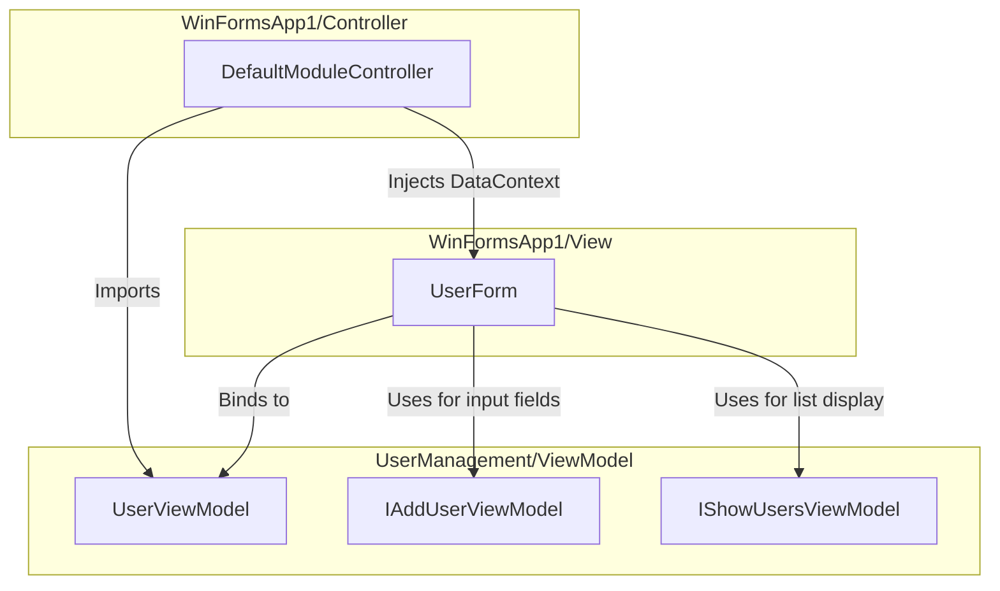

### Purpose

`WinFormsApp1/View` contains the single main window for the WinForms host: `UserForm`. This directory serves as the UI layer for the user management feature, bridging the shared MVVM logic to the WinForms platform. It exists to provide the visual surface where users view current accounts and add new ones, using imperative binding and event handlers rather than declarative XAML.

### Software Components

The directory contains one logical component: the `UserForm` class. This is a partial class split across three files:

- `UserForm.cs`: Contains the hand-written logic, including the `IMainView` contract, MEF export attributes, and all data binding setup.
- `UserForm.Designer.cs`: Contains the designer-generated layout code, control declarations, and `InitializeComponent()` method.
- `UserForm.resx`: Holds standard WinForms resource metadata.

See [UserForm.Designer.cs](WinFormsApp1/View/UserForm.Designer.md) for detailed file-level documentation, including layout specifics and binding behavior.

### Relationships

`UserForm` is the sole implementation of `IMainView<DialogResult, int>` in the WinForms project. The application's entry point (`Program.Main`) uses MEF to compose this form with `DefaultModuleController`. The controller injects `UserViewModel` as the form's `DataContext`, which triggers the form's binding logic to wire up UI controls to the view model's properties and commands.

The form depends on the `UserManagement.ViewModel` layer for all state and logic. It does not contain business logic itself; it merely displays state and forwards user input (like button clicks or text changes) to the view model. The `ListBox` uses a `BindingSource` to track changes in the user collection, while text boxes use standard `DataBindings` for immediate keystroke updates.

### Rough edges

- The `UserForm` title remains the designer default `"Form1"`, which is likely an oversight.
- The `DataContext` setter in `UserForm` does not clean up existing event subscriptions before re-binding, which could lead to duplicate handler invocations if the view model were swapped at runtime (though current usage sets it only once).
- Validation errors are only displayed for `FirstName` and `LastName`; any other validation errors in the view model are silently ignored by the form.

## Contents
- [UserForm.Designer.cs](WinFormsApp1/View/UserForm.Designer.md)