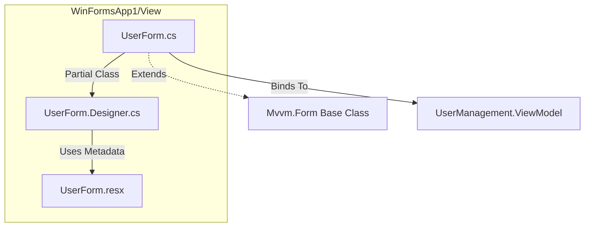

### Purpose

The `WinFormsApp1/View` directory contains the primary user interface for the user management application. It holds the `UserForm`, which serves as the main window for viewing and adding users. These files belong together because they constitute the complete visual presentation layer of the MVC architecture, specifically the "View" that interacts with the user directly.

### Software Components

This directory consists of a single logical component: the `UserForm`.

*   **`UserForm`**: The main window of the application. It is implemented as a partial class split across two files. The component displays a list of current users and provides input fields for adding new users. It handles data binding between the UI controls and the underlying view model, as well as validation error display.

### Relationships

The `UserForm` component is composed of three interdependent files that must exist together to function.

1.  **`UserForm.cs`**: This is the hand-written portion of the partial class. It contains the business logic for the view, including data bindings, event handlers (such as the save button click), and validation logic using the `ErrorProvider`. It imports the view model and exposes the form as the main view to the controller.
2.  **`UserForm.Designer.cs`**: This is the auto-generated portion of the partial class. It defines the control fields (like `txtFirstName`, `lstUsers`) and the `InitializeComponent()` method that constructs the layout. It depends on `UserForm.cs` to provide the class identity, but `UserForm.cs` depends on this file for the field declarations and initialization logic. You cannot rename or remove controls in `UserForm.cs` bindings without updating this file, and vice versa.
3.  **`UserForm.resx`**: This is the resource file paired with the designer code. It holds metadata for designer-managed components, such as the tray location of the `errorProvider`. It is consumed by `UserForm.Designer.cs` during design-time and compilation.

The `UserForm` inherits from a `Mvvm.Form` base class (external dependency) to handle MVVM plumbing like `DataContext` management. It depends on `UserManagement.Model` and `UserManagement.ViewModel` projects for the data structures it binds to. The controller (`DefaultModuleController`) in a separate project imports `UserForm` via the `Export` attribute to run the application.

### Rough edges

The form's `Text` property is still set to the default `"Form1"` in `UserForm.Designer.cs`, so the window title bar does not accurately reflect its purpose as the user management form.

## Contents
- [UserForm.Designer.cs](WinFormsApp1/View/UserForm.Designer.md)
- [UserForm.cs](WinFormsApp1/View/UserForm.md)
- [UserForm.resx](WinFormsApp1/View/UserForm.resx.md)