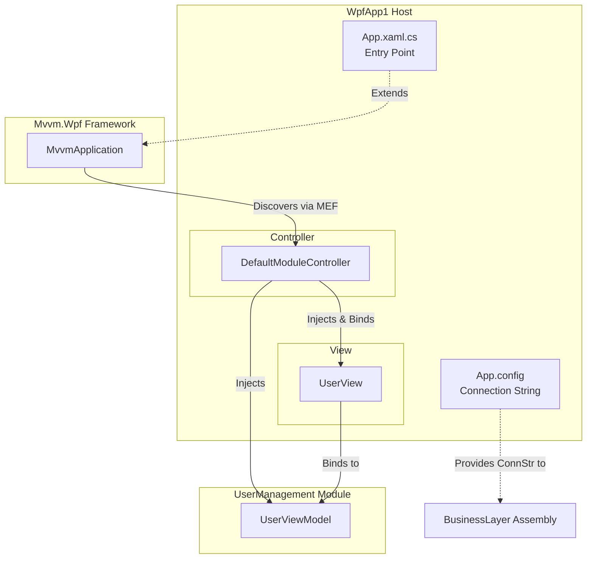

### Purpose

`WpfApp1` is the WPF desktop host for the solution. It provides the Windows entry point that bootstraps the application's modular architecture using the MEF container. Its contents belong together because they form the specific "shell" for this user-management feature: the startup logic, the configuration for the local database, and the UI components that display and manage user data.

### Software Components

The project is a .NET WPF application consisting of three main source code components:

*   **Application Bootstrap (`App`)**: Defined in `WpfApp1/App.xaml` and `App.xaml.cs`. This class derives from `Mvvm.Wpf.MvvmApplication`. It contains no custom logic; instead, it inherits the MEF container creation and module lifecycle management from its base class. Its sole role is to signal to the WPF runtime that this assembly contains a valid `Application` subclass.
*   **Module Controller (`DefaultModuleController`)**: Located in `WpfApp1/Controller/`. This is the single `IModuleController` export in the project. It acts as the orchestrator for the UI, responsible for injecting the View and ViewModel, binding them, and managing the window's lifecycle (`Show`/`Close`).
*   **Presentation Layer (`UserView`)**: Located in `WpfApp1/View/`. This is the main window defined by `UserView.xaml` and its code-behind. It presents a two-column layout for viewing existing users and adding new ones. It serves as a pure presentation surface, delegating all state and command logic to the `UserViewModel`.

Additional files include `AssemblyInfo.cs`, which defines WPF theme resource locations, and `App.config`, which stores the SQL Server connection string.

### Relationships

The `WpfApp1` project acts as the composition root for this specific UI feature. The flow begins with the WPF runtime instantiating `App`. `App` inherits `OnStartup` from `MvvmApplication`, which scans for `IModuleController` exports. In this project, it finds only `DefaultModuleController`.

`DefaultModuleController` depends on two external exports: `IMainView` (resolved to `UserView`) and `IMainViewModel` (resolved to `UserViewModel` from the `UserManagement` project). The controller binds the ViewModel to the View's `DataContext` and calls `Run()` to display the window. The `UserView` then binds to the properties and commands of `UserViewModel`, which in turn coordinates child view models for specific tasks like adding users.

The `App.config` file provides the `ConnectionString` key. Although `App` itself does not read this value, the `BusinessLayer` assembly (referenced by the app) reads it at runtime to initialize the NHibernate session. This means the WPF host is indirectly responsible for the database connection configuration, even though the data access logic lives in a shared layer.

### Rough edges

The `DefaultModuleController` bypasses the `IMainViewModel`'s shutdown contract by directly calling `Close()` on the window rather than invoking a cleanup method on the ViewModel. This suggests a loose coupling between the controller's lifecycle management and the ViewModel's state disposal.

## Contents
- [App.config](WpfApp1/App.md)
- [App.xaml](WpfApp1/App.xaml.md)
- [AssemblyInfo.cs](WpfApp1/AssemblyInfo.md)
- [Controller/](WpfApp1/Controller.md)
- [View/](WpfApp1/View.md)