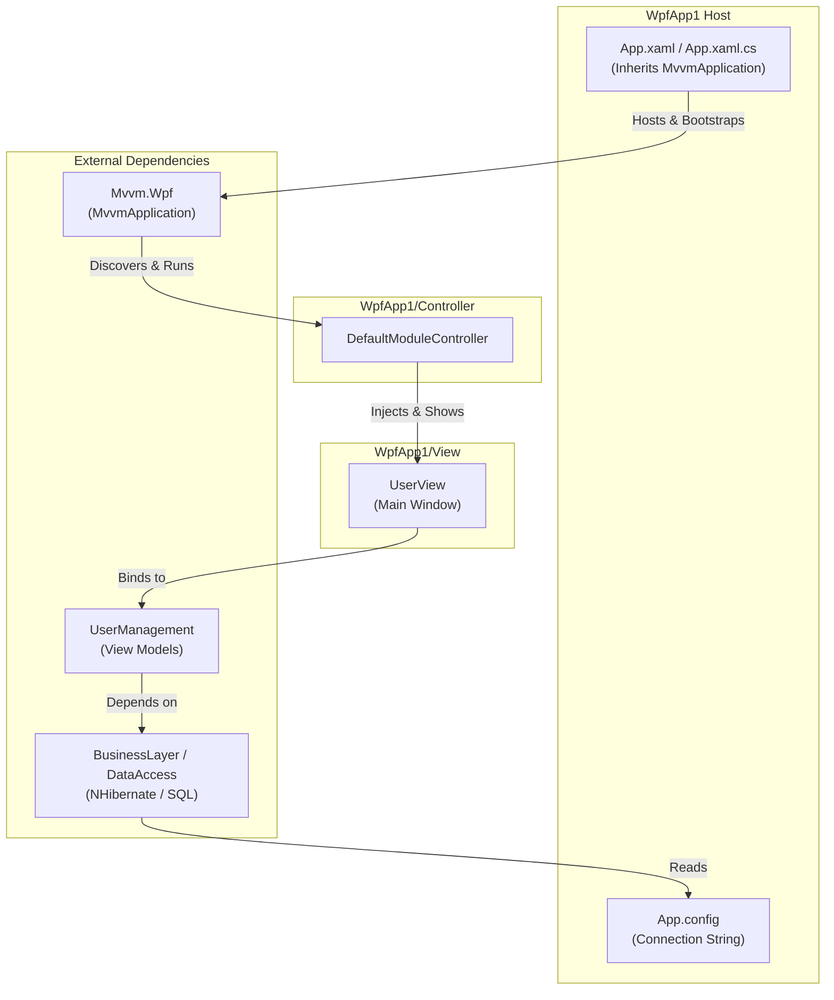

### Purpose

`WpfApp1` is the WPF desktop entry point for a user management application. It serves as the host shell that bootstraps the MEF-based composition container, discovers the application's single module, and displays the main `UserView` window. The directory groups the application's root definition (`App.xaml`/`App.xaml.cs`), the module controller that drives startup, and the primary UI view, keeping the presentation layer separate from the business logic and data access layers it depends on.

### Software Components

The application is built around a standard MVVM pattern orchestrated by the Mvvm library. The components are divided into three functional groups:

*   **Application Root**: Defined in [App.xaml](WpfApp1/App.xaml.md) and [App.xaml.cs](WpfApp1/App.xaml.cs.md). This partial class inherits from `MvvmApplication`, a base class that handles MEF container setup, module discovery, and exception handling. The `App` class itself contains no logic; it exists solely to bind the XAML root to the C# partial class and apply platform-specific attributes.
*   **Module Controller**: Located in the `Controller/` subdirectory, specifically [DefaultModuleController](WpfApp1/Controller/DefaultModuleController.md). This class implements the `IModuleController` interface. It is the only module export in the project and acts as the bridge between the host application and the main UI. It injects the main view and view model, then triggers `Show()` on the window during `Run()` and `Close()` during `Shutdown()`.
*   **Main View**: Located in the `View/` subdirectory, consisting of [UserView.xaml](WpfApp1/View/UserView.md) and [UserView.xaml.cs](WpfApp1/View/UserView.md). `UserView` is the single window presented to the user, containing UI for listing current users and adding new ones. The code-behind exports this window via `IMainView<bool?, double>`, allowing the controller to resolve it. The XAML handles layout and data bindings to view models from the `UserManagement` project.

Supporting files include [App.config](WpfApp1/App.md), which stores the SQL Server connection string for the local development database, and [AssemblyInfo.cs](WpfApp1/AssemblyInfo.md), which configures WPF theme resource locations.

### Relationships

The dependency flow is strictly top-down from the WPF host to the MEF modules, and from the Controller to the View.

1.  **Bootstrapping**: The WPF runtime instantiates `App` (derived from `MvvmApplication`). During `OnStartup`, `MvvmApplication` creates a MEF composition container and scans for `IModuleController` exports.
2.  **Module Execution**: The container discovers `DefaultModuleController`. The host calls `Initialize()` (a no-op here) and then `Run()`.
3.  **View Binding**: `DefaultModuleController` receives `IMainView<bool?, double>` (resolved as `UserView`) and `IMainViewModel` via constructor injection. It sets the `DataContext` of `UserView` to the `UserViewModel`, activating the data bindings defined in `UserView.xaml`.
4.  **Data Access**: The `UserViewModel` (external to this directory) relies on the `BusinessLayer`, which reads the `ConnectionString` from [App.config](WpfApp1/App.md) to connect to the local SQL Server database via NHibernate.

### Rough edges

*   The `[assembly: SupportedOSPlatform("windows")]` attribute is defined in both `App.xaml.cs` and the external `Mvvm.Wpf/MvvmApplication.cs`. While the compiler accepts this redundancy, it is unnecessary duplication.
*   `UserView.xaml` contains dead code: a `MyDebugConverter` resource that is only referenced in commented-out markup.
*   Validation error handling in `UserView.xaml` is inconsistent; the "First Name" field uses an inline error template, while the "Last Name" field uses a tooltip.

## Contents
- [App.config](WpfApp1/App.md)
- [App.xaml](WpfApp1/App.xaml.md)
- [App.xaml.cs](WpfApp1/App.xaml.cs.md)
- [AssemblyInfo.cs](WpfApp1/AssemblyInfo.md)
- [Controller/](WpfApp1/Controller.md)
- [View/](WpfApp1/View.md)