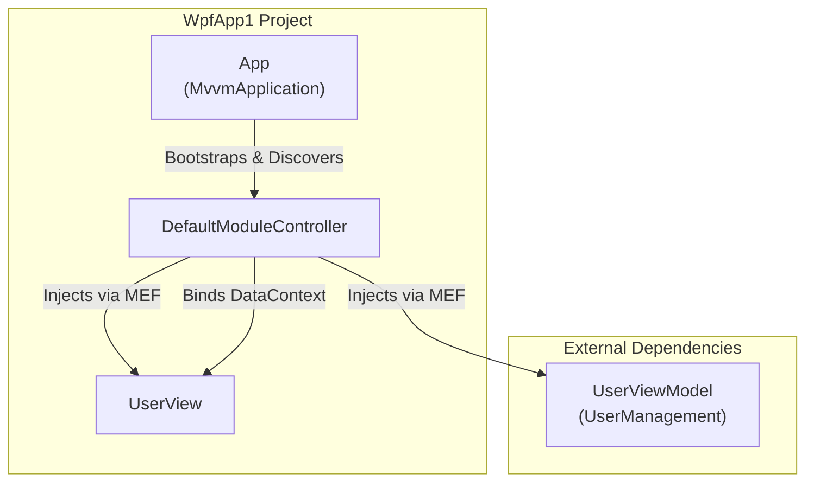

### Purpose

`WpfApp1` is the WPF desktop application project within the solution. It serves as the executable host shell that launches the application, bootstraps the MEF (Managed Extensibility Framework) composition container, and displays the main user interface. The contents belong together because they form the thin WPF-specific layer required to run the `UserManagement` business logic on the WPF platform, adhering to the MVVM pattern defined by the `Mvvm.Wpf` library.

### Software Components

The source code in this directory is divided into two main responsibilities: application bootstrapping and UI presentation.

*   **Application Entry Point**: Defined by [`App.xaml`](WpfApp1/App.xaml.md) and [`App.xaml.cs`](WpfApp1/App.xaml.cs.md). This component declares `WpfApp1.App` as a subclass of `MvvmApplication`. It contains no logic of its own; its sole purpose is to enable the base class's MEF scanning and lifecycle management.
*   **Lifecycle Controller**: Located in `Controller/`, specifically `DefaultModuleController.cs`. This class implements `IModuleController` and acts as the bridge between the host application and the business logic. It is responsible for initializing, running, and shutting down the main window.
*   **User Interface**: Located in `View/`, specifically `UserView.xaml` and `UserView.xaml.cs`. This component provides the main window for the "User Management" feature. The code-behind file registers the window as a MEF export, while the XAML file defines the visual structure and data bindings.
*   **Configuration & Metadata**: [`AssemblyInfo.cs`](WpfApp1/AssemblyInfo.md) provides WPF theme resource lookup metadata, and [`App.config`](WpfApp1/App.md) holds standard application configuration settings.

### Relationships

The architecture relies on MEF to wire the components together at runtime. [`App.xaml`](WpfApp1/App.xaml.md) establishes the application context by inheriting from `MvvmApplication`. Upon startup, `MvvmApplication` scans the application directory for assemblies and uses MEF to discover exported modules.

`DefaultModuleController` is the primary module discovered in this assembly. The MEF container injects `UserView` (as `IMainView`) and `UserViewModel` (from the `UserManagement` project) into `DefaultModuleController`'s constructor. The controller then binds the view model to the view's `DataContext` and manages the window's visibility.

The project file [`WpfApp1.csproj`](WpfApp1/WpfApp1.md) is critical for this discovery mechanism; by referencing `UserManagement`, it ensures the business logic assemblies are copied to the output directory, allowing `MvvmApplication` to find and compose them.

### Rough edges

The `App` class inherits error messages from `MvvmApplication` that are written in German, which may cause unexpected UI text in English-speaking environments. Additionally, the `[SupportedOSPlatform]` attribute is declared redundantly in both `App.xaml.cs` and the base `MvvmApplication` class.

## Contents
- [App.config](WpfApp1/App.md)
- [App.xaml](WpfApp1/App.xaml.md)
- [App.xaml.cs](WpfApp1/App.xaml.cs.md)
- [AssemblyInfo.cs](WpfApp1/AssemblyInfo.md)
- [WpfApp1.csproj](WpfApp1/WpfApp1.md)
- [Controller/](WpfApp1/Controller.md)
- [View/](WpfApp1/View.md)