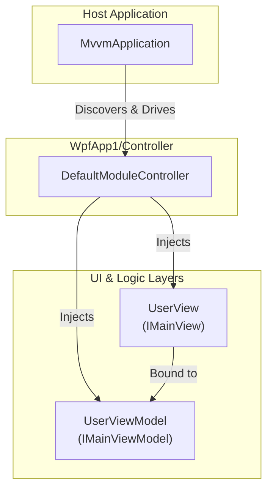

### Purpose

`WpfApp1/Controller` contains the application's bootstrapping controller, `DefaultModuleController`. This class acts as the entry point for the WPF application's lifecycle, handling the initialization, display, and teardown of the main window. It exists to satisfy the `IModuleController` interface required by the MEF (Managed Extensibility Framework) composition container used by the host application.

### Software Components

The directory contains a single source file: `DefaultModuleController.cs`.

*   **`DefaultModuleController`**: Implements `IModuleController` and serves as the concrete module export for the WPF assembly. It manages the lifecycle of the main UI by wiring the view (`IMainView`) to its view model (`IMainViewModel`) and controlling their visibility. As the only `IModuleController` export in this assembly, it defines the app's entire startup and shutdown sequence.

### Relationships

The controller sits at the intersection of the UI layer and the dependency injection container. `MvvmApplication` (the host) discovers this controller via MEF composition, injecting the main view and view model into its constructor.

*   **Dependency Injection**: The MEF container injects `UserView` (as `IMainView<bool?, double>`) and `UserViewModel` (as `IMainViewModel`) into `DefaultModuleController`.
*   **Lifecycle Management**: `MvvmApplication` calls `Initialize()`, `Run()`, and `Shutdown()` on this controller. `Run()` displays the window, while `Shutdown()` closes it.
*   **View-Model Binding**: The constructor binds the injected view model to the view's `DataContext`, establishing the MVVM connection before the window is shown.

## Contents
- [DefaultModuleController.cs](WpfApp1/Controller/DefaultModuleController.md)