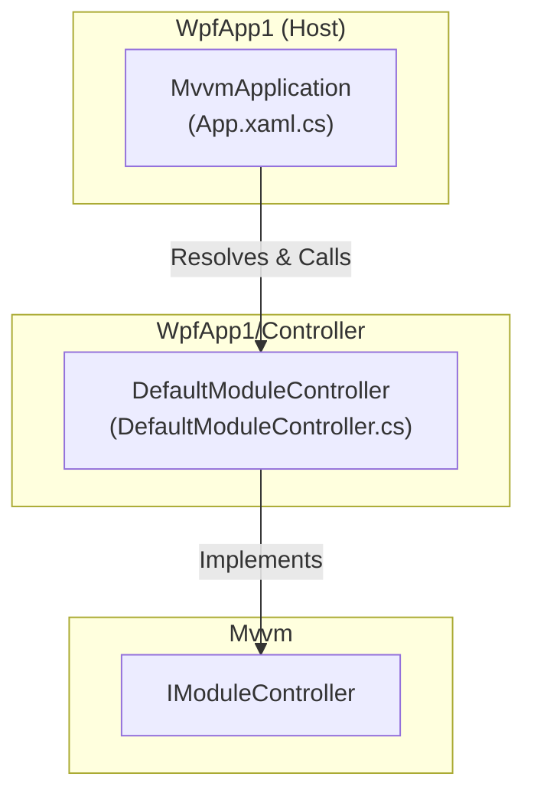

### Purpose

The `WpfApp1/Controller` directory contains the application's module lifecycle controller. It serves as the entry point for the WPF host's MEF composition process, ensuring the main window is initialized and displayed. Its sole content, `DefaultModuleController.cs`, belongs here because it implements the `IModuleController` contract required by the `MvvmApplication` base class to manage startup, execution, and shutdown.

### Software Components

The primary component in this directory is [DefaultModuleController](WpfApp1/Controller/DefaultModuleController.md), located in `DefaultModuleController.cs`. This class acts as a thin wrapper around the application's main view and view model. It receives `IMainView<bool?, double>` and `IMainViewModel` via MEF injection in its constructor, binds the view model to the view's `DataContext`, and maps the standard lifecycle callbacks to window operations. Specifically, `Run()` triggers `MainView.Show()`, and `Shutdown()` triggers `MainView.Close()`. The class is marked with `[Export(typeof(IModuleController))]`, making it the only module export in the `WpfApp1` project that the host application discovers and executes.

### Relationships

`DefaultModuleController` depends on the `IModuleController` interface from the `Mvvm` assembly to define its lifecycle contract. It relies on MEF for dependency injection, receiving the main view and view model through its `[ImportingConstructor]`. The caller is `MvvmApplication` (in `WpfApp1/App.xaml.cs`), which resolves `DefaultModuleController` from the composition container without referencing the class by name. During startup, `MvvmApplication` calls `Initialize()` (which is empty here), then `Run()` to show the window. During exit, it calls `Shutdown()` to close the window.

## Contents
- [DefaultModuleController.cs](WpfApp1/Controller/DefaultModuleController.md)