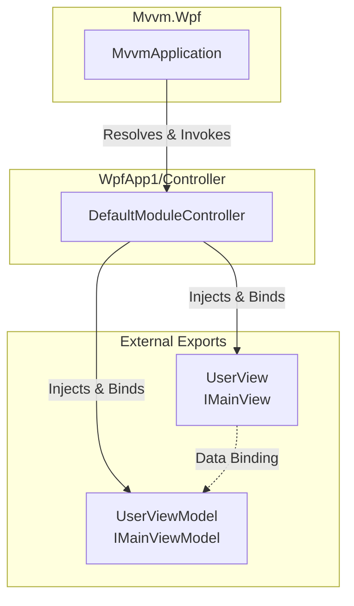

### Purpose

The `Controller` directory in `WpfApp1` holds the application’s entry point for module management. It contains a single file, `DefaultModuleController.cs`, which implements the `IModuleController` interface required by the MEF container. This class is responsible for composing the main window by binding the view model to the view and driving the application’s startup and shutdown sequences. Because it is the only module in this WPF project, removing it would prevent the application from starting.

### Software Components

This directory contains one source code component: the [DefaultModuleController](WpfApp1/Controller/DefaultModuleController.md) class.

This class acts as the bridge between the MEF container and the WPF UI components. It imports the main view (`UserView`) and the main view model (`UserViewModel`) via constructor injection. Its primary duties are:
*   **Composition:** It sets the `DataContext` of the view to the view model, enabling data binding.
*   **Lifecycle Management:** It implements `Initialize()` (currently empty), `Run()` (which opens the main window using `Show()`), and `Shutdown()` (which closes the main window).

### Relationships

The `DefaultModuleController` sits at the intersection of the MEF dependency injection framework and the WPF UI layer. It does not contain business logic itself but orchestrates the interaction between the view and view model exports.

*   **Dependencies:** The controller depends on `IMainView<bool?, double>` and `IMainViewModel`. These are resolved from other projects: the view is exported by `WpfApp1/View/UserView.xaml.cs`, and the view model is exported by `UserManagement/ViewModel/UserViewModel.cs`.
*   **Caller:** The `MvvmApplication` base class (in `Mvvm.Wpf`) discovers this controller via MEF. It calls `Initialize()` and `Run()` during `OnStartup`, and `Shutdown()` during `OnExit`. No other code references `DefaultModuleController` by name.
*   **Flow:** On startup, MEF instantiates the controller, injects the view and view model, and the controller binds them. `Run()` then displays the window. The application remains active via the WPF message loop. When the user closes the window, `OnExit` triggers `Shutdown()`, which calls `Close()` on the view (though the window is often already closed).

### Rough edges

The controller never invokes the `CloseWindow()` or `Shutdown()` methods declared on `IMainViewModel`, even though the view model is available. Instead, it directly calls `MainView.Close()`. This bypasses the view model’s potential cleanup logic, suggesting a minor disconnect between the lifecycle contract and the implementation. Additionally, the `bool?` type parameter in `IMainView<bool?, double>` is vestigial, as the view is a standard `Window` and never shown as a dialog.

## Contents
- [DefaultModuleController.cs](WpfApp1/Controller/DefaultModuleController.md)