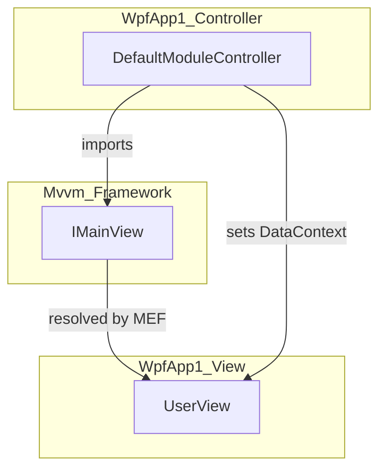

### Purpose

`WpfApp1/View` serves as the presentation layer entry point for the WPF application. Its primary responsibility is to provide the main visual interface that the application controller displays to the user. The contents belong together because they constitute a single WPF window component, split between markup (`XAML`) and code-behind (C#), following standard WPF conventions.

### Software Components

The directory contains one main component: the `UserView` window. This window acts as the host for the "User Management" functionality.

- **`UserView`**: Defined jointly by [UserView.xaml](WpfApp1/View/UserView.md) and [UserView.xaml.cs](WpfApp1/View/UserView.md). The C# file acts as a lightweight wrapper that registers the window as a MEF (Managed Extensibility Framework) export. It implements the `IMainView<bool?, double>` interface but contains no specific business logic; all UI structure, bindings, and styling are defined in the XAML file.

### Relationships

The dependency flow is strictly from the application controller to this view. `DefaultModuleController` (located in `WpfApp1/Controller`) does not reference `UserView` directly. Instead, it imports the `IMainView<bool?, double>` interface. MEF resolves this import to the `UserView` class because it is the only class in the WPF project exporting that specific interface signature.

Once resolved, the controller assigns the `UserViewModel` as the `DataContext` for the view. All data bindings within `UserView.xaml` (such as commands and user lists) resolve against this view model. The code-behind file `UserView.xaml.cs` is critical for this discovery process; if the `[Export]` attribute or interface implementation were removed, MEF would fail to locate a view to display, preventing the application from launching.

## Contents
- [UserView.xaml](WpfApp1/View/UserView.md)
- [UserView.xaml.cs](WpfApp1/View/UserView.xaml.md)