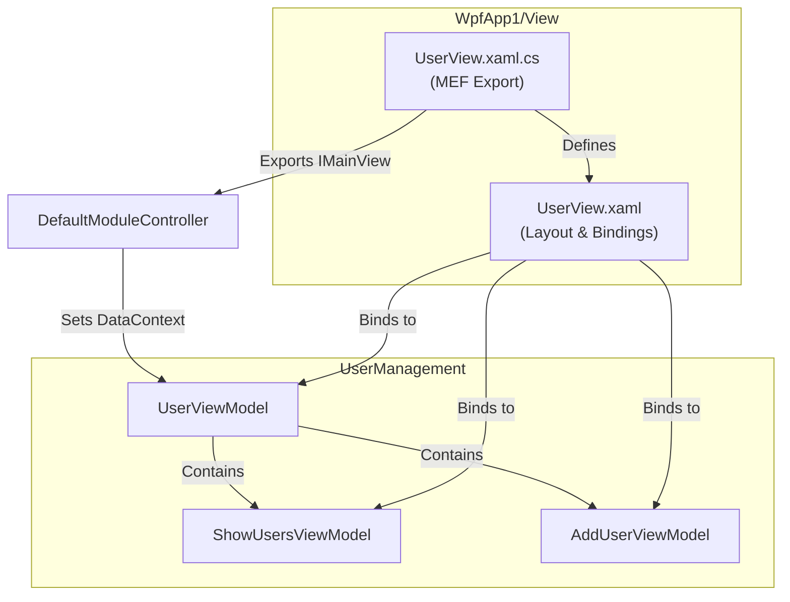

### Purpose

`WpfApp1/View` contains the single main window for the WPF host application. It holds the user interface for user management, specifically listing current users and adding new ones. The directory consists of two files that work together: the XAML definition for layout and bindings, and the code-behind that registers the window with the MEF composition container.

### Software Components

The directory contains one UI component: the `UserView` window. This component is split across two files:

*   [UserView.xaml](WpfApp1/View/UserView.md): Defines the visual layout, including the "Current Users" list and the "Add New User" form. It handles all data bindings to the view-models and contains specific validation error templates.
*   [UserView.xaml.cs](WpfApp1/View/UserView.md): The code-behind for the window. It is minimal, primarily serving to export the view via the `[Export(typeof(IMainView<bool?, double>))]` attribute so the application controller can find it.

### Relationships

The component relies on a strict separation between presentation and logic. `UserView` does not contain business logic; instead, it binds to view-models from the `UserManagement` project. Specifically, the XAML binds to `UserViewModel` (the root context), which exposes `ShowUsersViewModel` for loading the user list and `AddUserViewModel` for handling input and saving.

The dependency direction flows from the Controller to this View. `DefaultModuleController` imports the `IMainView<bool?, double>` contract. Because `UserView` is the only exporter of this contract, removing or breaking the code-behind in [UserView.xaml.cs](WpfApp1/View/UserView.md) would prevent the application from starting. At runtime, the controller sets the `DataContext` of the window to the resolved `UserViewModel`, activating the bindings defined in the XAML.

### Rough edges

The XAML file contains dead code for the `MyDebugConverter` resource, which is only referenced in commented-out markup. Additionally, the two input fields in the "Add New User" section handle validation errors inconsistently: the first name field uses an inline error template, while the last name field uses a tooltip.

## Contents
- [UserView.xaml](WpfApp1/View/UserView.md)
- [UserView.xaml.cs](WpfApp1/View/UserView.xaml.md)