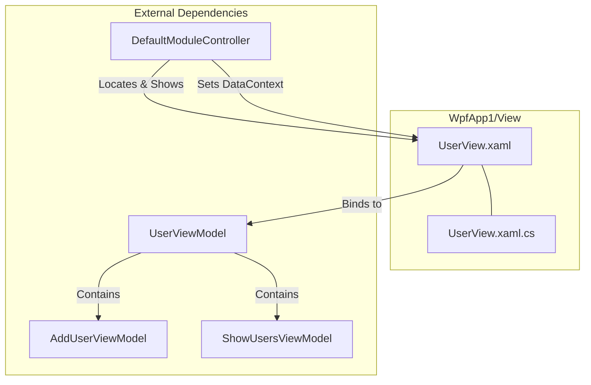

### Purpose

The `WpfApp1/View` directory serves as the presentation layer for the WPF host application (`WpfApp1`). It contains the User Interface (UI) definitions that allow users to interact with the system's features, specifically managing user data. These files belong together because they define the visual structure and user interaction points for the `UserManagement` module, acting as the "face" of the application while delegating business logic to the underlying ViewModels.

### Software Components

This directory currently contains a single logical component: the main application window.

*   **`UserView`**: Defined across `UserView.xaml` and `UserView.xaml.cs`, this is the primary window of the WPF app. It presents a two-column layout: a list of current users on the left and a form to add new users on the right. The component is a pure presentation surface; it holds no business logic. Instead, it binds to the `UserViewModel` and its child ViewModels (`AddUserViewModel`, `ShowUsersViewModel`) to display data and handle user commands. It is exported via MEF to be discovered by the application's controller.

### Relationships

The relationship between the view and the rest of the application is strictly one-way: the view consumes data and commands from the ViewModels, but never modifies the model or view-model logic directly. The `UserView` window is the entry point for the UI, but it does not launch itself. It relies on the `DefaultModuleController` in `WpfApp1/Controller/` to locate it via its MEF export (`IMainView<bool?, double>`), inject the `UserViewModel` as the `DataContext`, and manage its lifecycle (`Show` and `Close`).

Within the view, the XAML defines the layout and binds controls to specific properties. The "Add User" form binds to `AddUserViewModel`, which handles validation and the save command. The user list binds to `ShowUsersViewModel`, which asynchronously loads active users when the window is loaded. A `DebugConverter` is defined as a resource in the XAML, but it is currently unused because the binding that would consume it is commented out.

## Contents
- [UserView.xaml](WpfApp1/View/UserView.md)